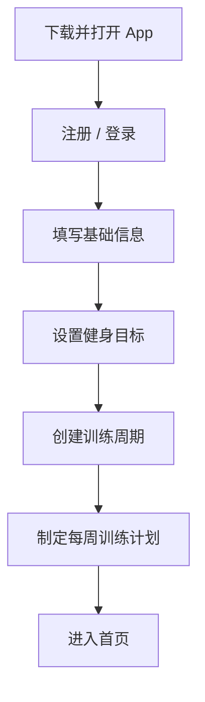
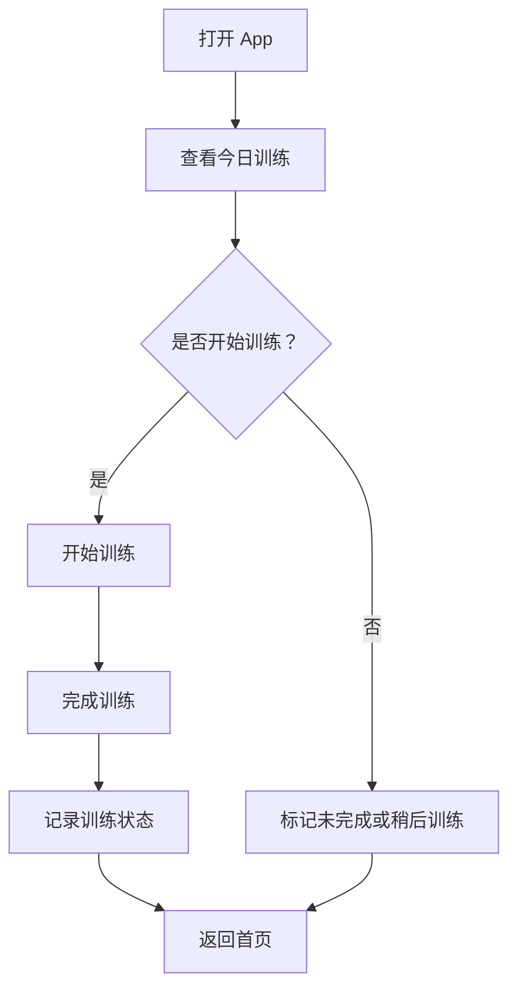
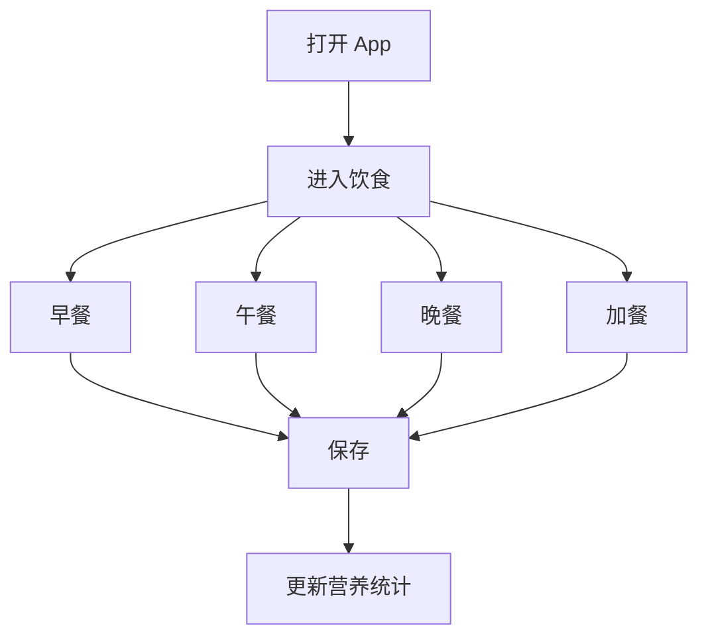
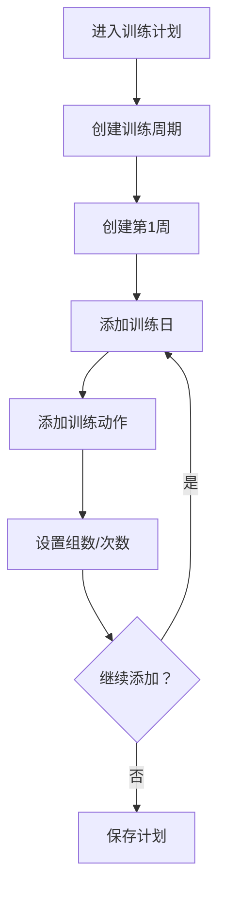
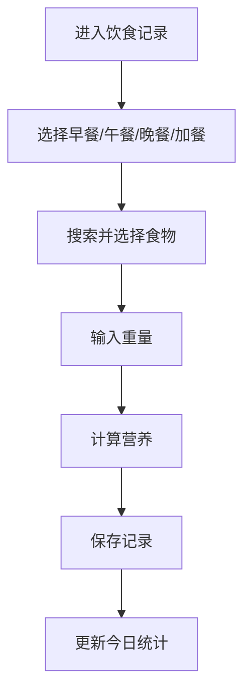
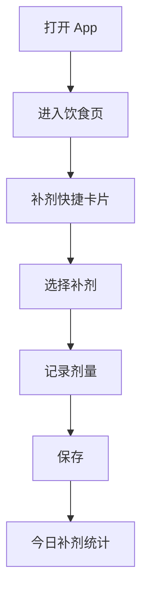
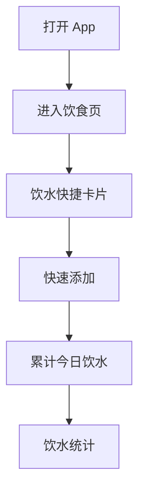
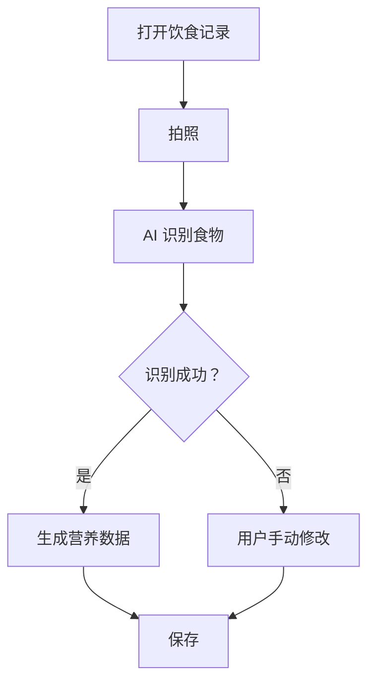
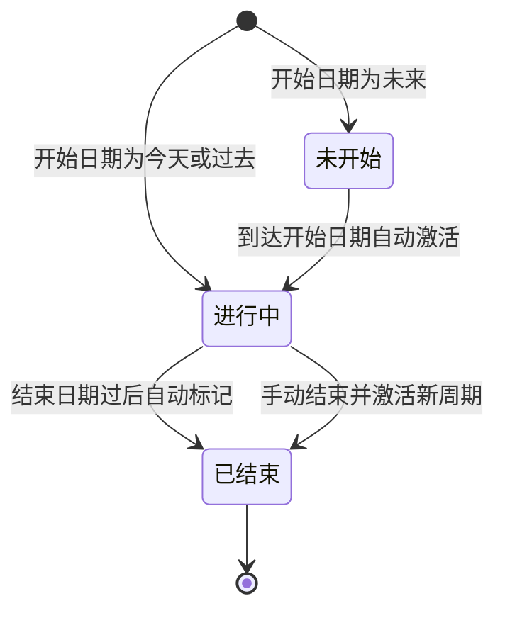
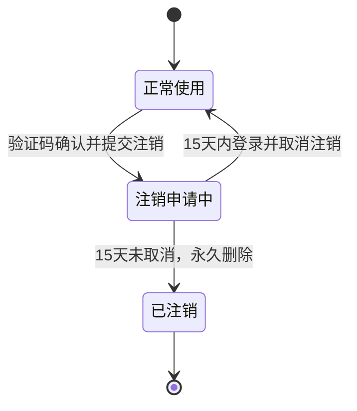

# FitMate 健身助手 App · 产品需求文档（PRD）

---

## 第0部分：文档信息

| 项目 | 内容 |
| --- | --- |
| 产品名称 | FitMate（v1.4 确认） |
| 文档版本 | v1.6 |
| 当前阶段 | **定稿·成稿**（四部分结构已完成，遗留需求问题已关闭；v1.5 完成压力测试 P0 修复；v1.6 完成其余六模块页面原型并关闭 13 项 P1/P2 缺口；技术栈与平台形态由产品负责人另行撰写技术文档确定） |
| 负责人 | 待定 |
| 最近更新 | 2026-09-12 |

### 更新记录

| 版本 | 日期 | 阶段 | 变更说明 | 作者 |
| --- | --- | --- | --- | --- |
| v0.1 | 2026-09-07 | 初稿 | 建立 PRD 框架，完成第一部分：用户画像、使用场景、产品目标初稿 | — |
| v0.2 | 2026-09-07 | 初稿 | 补充 1.5 需求范围管理：明确 V1 七大功能模块与 Out-of-Scope 清单；知识库移出 V1，同步调整 1.3/1.4 | — |
| v0.3 | 2026-09-08 | 初稿 | 确认饮食模块采用内置食物营养数据库，更新 1.5/1.6 | — |
| v0.4 | 2026-09-08 | 中稿 | 新增第二部分 2.1 核心业务流程图：首次使用、每日使用、训练计划管理、饮食记录、V2 AI 食物识别共 5 条流程 | — |
| v0.5 | 2026-09-09 | 中稿 | 重构每日使用流程：拆分为训练业务线与饮食业务线两条独立流程；解决"否"分支缺口；其余流程重新编号 | — |
| v0.6 | 2026-09-09 | 中稿 | 新增流程六补剂业务线、流程七饮水业务线；确认补剂/饮水入口为饮食页面快捷卡片，不放底部导航 | — |
| v0.7 | 2026-09-09 | 中稿 | 新增 2.2 需求管理：模块编码、P0-P3 优先级定义、28 条需求列表；同步 1.5 范围（训练历史、周/月统计、训练日历纳入 V1） | — |
| v0.8 | 2026-09-09 | 中稿 | 需求列表补充 WORKOUT-008 调整训练动作顺序（P1，V1） | — |
| v0.9 | 2026-09-10 | 中稿 | 新增 2.3 信息架构（V1 五 Tab 结构）；周报/月报更名为周/月统计以符合 v0.7 边界；标记体重记录、官方动作库等需求缺口 | — |
| v1.0 | 2026-09-11 | 定稿 | 新增第三部分 3.1 训练计划模块页面原型与交互说明；确认官方动作库（约 80 个）纳入 V1；新增 WORKOUT-009/010，扩展 WORKOUT-001/004 | — |
| v1.1 | 2026-09-11 | 定稿 | 新增 3.2 边缘情况处理（全模块 16 类）；确认云端同步方案、V1 不支持离线；新增 STAT-005 记录体重；标记提醒功能与 V1 权限申请范围问题 | — |
| v1.2 | 2026-09-11 | 定稿 | PRD 修订：V1 不做提醒（新增 SYSTEM-004，V2）；权限改为按需申请（JIT）；新增 3.3 自动保存草稿（SYSTEM-005，V1） | — |
| v1.3 | 2026-09-11 | 定稿 | 新增第四部分上线计划：里程碑、四阶段开发优先级、版本规划（V1.0~V3.0）、上线验收标准、迭代原则；同步 SYSTEM-003 版本为 V1.1；提醒功能归位 V2.0 | — |
| v1.4 | 2026-09-11 | 定稿 | 关闭遗留项：确认产品名称 FitMate、食物数据来源（公开数据集+自建补充）、成功指标目标值；新增 3.4 每日营养目标计算规则、3.5 训练总结页；技术栈由产品负责人另行提供文档 | — |
| v1.5 | 2026-09-12 | 定稿（压力测试修订） | 修复 7 项 P0：新增 3.1.10 训练执行页（原 3.1.10~3.1.14 顺延为 3.1.11~3.1.15）；统一训练日四态模型并定义状态判定规则；确认一天可添加多个训练（追加，废除覆盖提示）；修正流程六/七入口为饮食页快捷卡片；2.4 取消单独立章并入第三部分；补账号体系决策（邮箱+密码、找回密码、注销账号、隐私政策，新增 AUTH-004/005、WORKOUT-011） | — |
| v1.6 | 2026-09-12 | 定稿（页面原型补全） | 补全其余六模块页面原型与交互说明：3.6 用户（登录注册/首次设置/我的）、3.7 首页 Dashboard、3.8 饮食、3.9 补剂、3.10 饮水、3.11 数据统计；关闭 13 项 P1/P2 缺口：饮食 7 天补记窗口、食物重量校验、NUTRITION-002 明确为自定义食物、补剂单位/目标字段、周/月统计指标定义（含营养均值与完成率公式）、训练周期生命周期、"今日"00:00 边界、未完成当日可撤销、饮水快捷档位、体重趋势折线图、多设备登录规则、营养目标重算触发扩展、WORKOUT-009 优先级修正为 P0 | — |

> 迭代原则：初稿想清楚"为什么"，中稿想清楚"是什么"，定稿想清楚"怎么做"。每部分需评审确认后推进下一部分。

---

## 第一部分：需求背景与目标（初稿）

### 1.1 产品背景：为什么要做

1. **新手"不知道怎么练"**：健身新手普遍缺乏系统的训练计划，主要照短视频碎片化跟练，动作安排不科学、难以坚持，无法养成规律训练习惯。
2. **"不会吃"是普遍短板**：多数用户不会计算蛋白质、碳水、脂肪摄入，训练效果大打折扣；而饮食记录工具（如薄荷健康）与训练记录工具（如 Keep、Fitbod）相互割裂。
3. **信息噪音大，缺乏可靠知识来源**：网络健身内容质量参差不齐，追求科学健身的用户缺少基于循证（evidence-based）的高质量内容入口。
4. **数据分散，无法长期分析**：有经验的用户需要自定义训练周期、追踪长期数据，但现有工具要么太浅（记录类），要么太重（专业类），缺少"训练 + 饮食 + 补剂 + 知识"集中管理的轻量方案。

**产品定位（一句话）**：一款面向健身人群的**训练计划 + 饮食营养 + 循证知识**一站式健身助手，帮助新手养成科学训练习惯，帮助进阶用户集中管理与分析训练数据。

### 1.2 目标用户：为谁做

#### 用户一：健身新手（主要用户）

| 维度 | 描述 |
| --- | --- |
| 年龄 | 18～30 岁 |
| 职业 | 大学生、刚工作的上班族 |
| 特征 | 健身 1 年以内；不知道如何安排训练计划；经常照着短视频练；不会计算蛋白质/碳水/脂肪摄入；希望养成规律训练习惯 |
| 核心需求 | ① 清晰的训练计划 ② 记录每天的训练和饮食 ③ 学习科学健身知识 |

#### 用户二：有训练经验的健身爱好者

| 维度 | 描述 |
| --- | --- |
| 年龄 | 20～40 岁 |
| 特征 | 已坚持训练 1 年以上；有自己的训练计划；会根据目标调整训练周期；关注训练数据和营养摄入；希望所有数据集中管理 |
| 核心需求 | ① 自定义训练动作和训练周期 ② 查看历史训练数据 ③ 记录每日饮食和补剂 ④ 分析长期训练效果 |

#### 用户三：追求科学健身的人

| 维度 | 描述 |
| --- | --- |
| 特征 | 喜欢学习健身知识；不盲目相信网络信息；愿意阅读高质量内容；希望了解训练和营养背后的原理 |
| 核心需求 | ① 查看循证健身知识 ② 获取可靠的训练和饮食建议 ③ 未来希望通过 AI 获得个性化分析 |

### 1.3 用户使用场景（User Scenario）

#### 场景一：制定训练计划（V1）

用户下载 App 后，根据自己的训练目标（增肌、减脂或力量训练）创建未来几周的训练计划，并可自由调整每天的训练内容和动作。

#### 场景二：训练过程中（V1）

到达健身房后，用户打开 App 查看当天的训练内容，按计划完成训练并记录完成情况。

#### 场景三：记录饮食（V1）

每天三餐或加餐后，用户记录当天摄入的食物，查看蛋白质、碳水、脂肪和总热量是否达到目标。

> 未来版本：用户可直接拍照食物，由 AI 自动识别食物并填写营养信息。

#### 场景四：记录补剂与饮水（V1）

用户服用蛋白粉、肌酸等补剂时可快速打卡；喝水后点击按钮即可累计饮水量，帮助养成补水习惯。

#### 场景五：学习科学健身（未来版本）

训练结束或遇到疑问时，用户希望查看 App 内的循证健身知识，学习训练、营养和恢复等内容，并可直接向 AI 提问，获得基于知识库的个性化建议。

> 该场景涉及的知识库与 AI 能力已移出 V1 范围（见 1.5），计划在后续版本迭代。

### 1.4 产品目标与成功指标

#### V1 产品目标

1. 帮助健身新手**完成从"随便练"到"按计划练"的转化**：新用户在首周内创建训练计划并完成 ≥3 次训练打卡。
2. 建立**记录习惯**：次日留存率与 7 日留存率达标，饮食/训练记录人均天数持续提升。
3. 建立**一目了然的数据反馈**：通过每日数据统计面板（训练/饮食/饮水/补剂），让用户每天打开 App 即可对照目标查看完成情况。

#### 成功指标（目标值已于 v1.4 确定，上线后按实际数据校准）

| 类型 | 指标 | 目标值 |
| --- | --- | --- |
| 激活 | 首周创建训练计划的新用户占比 | ≥ 60% |
| 习惯 | 次日留存 | ≥ 40% |
| 习惯 | 7 日留存 | ≥ 25% |
| 参与 | 人均每日记录次数（训练/饮食/饮水） | ≥ 3 次 |
| 参与 | 每日数据面板查看率 | ≥ 70% |
| 长期 | 周训练打卡完成率 | ≥ 50% |
| 习惯 | 饮食记录渗透率（当日记录 ≥1 餐用户占比） | ≥ 60% |

### 1.5 需求范围管理（Scope Management）

#### In-Scope（本次开发范围）

**一、用户模块**

- 用户注册、登录（v1.5 确认：邮箱 + 密码；含找回密码）
- 注销账号（v1.5 新增：应用商店合规必需）
- 隐私政策与用户协议（v1.5 新增：注册页勾选 + 独立页面）
- 用户个人资料管理
- 设置个人健身目标（增肌、减脂、重塑、保持）
- 设置基础身体信息（身高、体重、年龄、性别）

**二、训练计划模块**

- 创建训练计划
- 自定义训练周期（支持多周）
- 自定义每天训练内容（含休息日设置；一天可添加多个训练，v1.5）
- 训练执行页：逐组记录完成情况、实际重量与次数、组间休息计时（v1.5 新增，WORKOUT-011）
- 新增、编辑、删除训练动作
- 调整动作顺序
- 查看今日训练计划
- 标记今日训练完成
- 查看训练历史（v0.7 纳入，WORKOUT-007）

**三、饮食记录模块**

- 记录早餐、午餐、晚餐、加餐（支持过去 7 天补记与编辑，v1.6）
- 内置食物营养数据库：用户搜索并选择食物，自动带出热量与三大营养素
- 自定义食物（名称 + 每 100g 营养素，存入"我的食物"，v1.6）
- 手动填写食物重量（范围 1~5000g/ml，v1.6）
- 自动统计：热量、蛋白质、碳水、脂肪

**四、补剂模块**

- 添加补剂（名称、单位、单次剂量、每日目标，v1.6）
- 自定义补剂类型
- 每日补剂打卡（一天多次，每次带时间戳，v1.6）
- 查看当天补剂记录

**五、饮水模块**

- 快速记录饮水量（预设档位：100/250/500ml，v1.6）
- 自定义输入饮水量
- 自动统计每日饮水总量

**六、数据统计模块**

- 首页 Dashboard：今日数据总览（v0.7 纳入，SYSTEM-001）

展示每日数据：

- 今日训练是否完成
- 今日热量摄入
- 今日蛋白质摄入
- 今日碳水摄入
- 今日脂肪摄入
- 今日饮水量
- 今日补剂记录

周期统计（v0.7 纳入）：

- 本周训练统计（STAT-002，含营养日均汇总，v1.6）
- 本月训练统计（STAT-003，含营养日均汇总，v1.6）
- 训练日历（STAT-004，P2，可后置到 V1.x 小版本）
- 体重趋势折线图（近 7/30/90 天，v1.6）

**七、基础设置**

- 修改个人信息
- 修改训练目标
- 修改每日饮水目标（可选）
- 退出登录（v1.6）
- 数据云端同步（v1.1 确认：云端方案，V1 不支持离线，见 1.6）

#### Out-of-Scope（本次不开发）

为保证 V1 能够快速上线，以下功能暂不开发。

**AI 功能**

- AI 训练计划生成、AI 饮食分析、AI 教练、AI 问答、AI 数据分析

**AI 识别**

- 拍照识别食物、条形码识别食品、AI 动作识别、视频动作分析

**科学知识库**

- 健身百科、营养百科、补剂百科、文献阅读、科学文章推荐

**商业化功能**

- 会员系统、支付、商城、课程购买

**高级统计**

- 周报、月报（报告形式）、趋势分析、AI 报告、数据导出
- 边界说明（v0.7）：简单的本周/本月训练汇总数字（STAT-002/003）属 V1 In-Scope；报告形式的周报/月报及趋势分析仍不做

**提醒功能（v1.2 纳入 Out-of-Scope）**

- 训练提醒、饮水提醒、补剂提醒、提醒设置页面
- V1 不提供提醒功能，仅预留扩展能力；V2 开发（SYSTEM-004），届时才申请通知权限

### 1.6 待确认问题（评审清单）

**已确认**

- **功能范围**：V1 以用户、训练计划、饮食记录、补剂、饮水、每日数据统计、基础设置七大模块为核心；AI 功能、AI 识别、知识库、商业化、高级统计全部移出 V1。
- **商业模式**：V1 不含任何商业化功能。
- **食物数据**：内置食物营养数据库，用户搜索选择食物后自动带出营养信息。
- **数据存储方案（v1.1）**：云端同步方案，V1 不支持离线使用（依据 3.2.13 离线处理），V2 增加本地缓存与断网恢复同步。
- **产品名称（v1.4）**：确定为 FitMate。
- **食物数据库来源（v1.4）**：以公开数据集（《中国食物成分表》等）为基础导入，团队自建补充校对常见加工食品；不使用第三方付费 API。
- **成功指标目标值（v1.4）**：1.4 节指标表已填入目标值，上线后按实际数据校准。
- **每日营养目标（v1.4）**：系统自动计算 + 允许手动调整，规则见 3.4。
- **训练总结页（v1.4）**：内容结构已定义，见 3.5。
- **账号体系（v1.5）**：V1 采用邮箱 + 密码注册/登录，找回密码走邮箱验证码；提供注销账号（二次确认，15 天冷静期后删除数据）；隐私政策与用户协议随 V1 上线（注册页勾选 + 独立页面）。第三方登录（微信/Apple）与手机号短信登录移至 V2。决策理由：V1 无短信服务成本、实现最简；放弃方案：手机号短信登录——需采购短信服务，V2 视商业化需求再定。
- **一天多训练（v1.5）**：支持（如上午有氧 + 下午力量），同一天重复添加为**追加**而非覆盖；放弃方案：一天仅一个训练 + 覆盖提示——与"点击某天进入编辑页"的入口逻辑冲突，且不符合真实训练场景。
- **训练日状态模型（v1.5）**：四种状态（未开始 / 已完成 / 未完成 / 休息日）；当天结束仍未执行的计划训练，次日自动记"未完成"，保证完成率统计口径一致。

**待确认 / 外部输入**

1. **技术栈与平台形态**：由产品负责人另行撰写技术栈文档确定，本 PRD 暂不锁定；需在技术设计（排期第 3 周）前提供。

---

## 第二部分：方案概述（中稿）

### 2.1 核心业务流程图（Business Flow）

每日使用按**两条独立业务线**组织：训练线与饮食线相互解耦，无强制先后顺序，用户按需进入。

#### 流程一：用户首次使用



#### 流程二：训练业务线（Workout Flow · 核心业务）



#### 流程三：饮食业务线（Nutrition Flow · 核心业务）



#### 流程四：训练计划管理流程



#### 流程五：饮食记录详细流程（从饮食业务线各餐次分支进入）



#### 流程六：补剂业务线

入口：**饮食页面中的快捷卡片**（v0.6 决策：不放底部导航，避免导航过载）。



#### 流程七：饮水业务线

入口：**饮食页面中的快捷卡片**，与补剂并列，支持一键快速添加。



#### 流程八：AI 食物识别（V2 · 未来版本）



#### 图注（Flow Description）

产品围绕用户每天的健身行为构建完整闭环：

1. **首次使用**：用户完成注册、填写基础信息、设定健身目标，并创建训练周期和训练计划。
2. **每日使用（双业务线，v0.5 重构）**：训练线与饮食线相互独立——训练线覆盖"查看今日训练 → 开始/标记未完成 → 记录状态"；饮食线覆盖"选择餐次 → 记录 → 保存并更新营养统计"。相比原线性流程，降低单次使用负担，符合"想到什么记什么"的真实场景。
3. **快捷打卡（v0.6 补充）**：补剂与饮水不设独立业务线、**不放底部导航**，作为**饮食页面中的快捷卡片**入口（流程六/七），降低导航负担，保持打卡动作轻量。
4. **训练计划管理**：支持以"训练周期"为单位管理计划，每周训练内容可独立配置，满足不同阶段（增肌、减脂、减载周等）的训练需求。
5. **饮食管理**：V1 采用内置食物数据库手动记录食物，V2 增加 AI 拍照识别，降低记录成本，提高长期使用率。

#### 2.1 评审备注

1. **已解决（v0.5）**：原流程二"今天是否训练？"的"否"分支未定义——新训练业务线中已明确为"标记未完成或稍后训练"。
2. **已重构（v0.5）**：原"每日使用线性流程"（训练→饮食→补剂→饮水→统计）重构为训练/饮食两条独立业务线。
3. **已解决（v0.6）**：补剂与饮水的入口已确定为**饮食页面中的快捷卡片**，不放底部导航（流程六/七）。
4. **流程五已按 v0.3 决策调整**：原"添加食物"改为"搜索并选择食物"，与内置食物营养数据库决策保持一致。
5. **已解决（v1.5）——2.4 不再单独立章**：原计划的 2.4 功能流程（各模块页面级流程）并入第三部分各模块细节方案（训练模块见 3.1，其余模块已于 v1.6 补全，见 3.6~3.11），消除"定稿仍待撰写"的矛盾；底部导航**不含**补剂/饮水独立入口（见 2.1 流程六/七）。
6. **已修正（v1.5）**：流程六/七图原画为"首页 → 补剂/饮水"，与 v0.6 决策（饮食页快捷卡片）矛盾，已修正为"进入饮食页 → 快捷卡片"。

---

### 2.2 需求管理：需求列表与优先级（Requirements List）

#### 模块编码

| 编码 | 模块 |
| --- | --- |
| AUTH | 用户模块 |
| WORKOUT | 训练模块 |
| NUTRITION | 饮食模块 |
| SUPPLEMENT | 补剂模块 |
| WATER | 饮水模块 |
| STAT | 统计模块 |
| SYSTEM | 系统模块 |

#### 优先级定义

| 优先级 | 含义 |
| --- | --- |
| P0 | 没有它，产品无法使用（必须开发） |
| P1 | 核心功能，第一版必须完成 |
| P2 | 优化功能，可以放到后续小版本 |
| P3 | 未来版本 |

#### 需求列表

| 需求ID | 模块 | 需求描述 | 优先级 | 版本 | 状态 |
| --- | --- | --- | --- | --- | --- |
| AUTH-001 | 用户 | 用户注册/登录（邮箱 + 密码，支持找回密码，见 1.6 v1.5 决策） | P0 | V1 | 未开发 |
| AUTH-002 | 用户 | 完善个人资料（身高、体重、年龄、性别） | P0 | V1 | 未开发 |
| AUTH-003 | 用户 | 设置健身目标（增肌、减脂、重塑、保持）与目标值；每日营养目标自动计算、可手动调整（见 3.4） | P1 | V1 | 未开发 |
| AUTH-004 | 用户 | 注销账号（二次确认，15 天冷静期后删除数据，合规必需） | P0 | V1 | 未开发 |
| AUTH-005 | 用户 | 隐私政策与用户协议（注册页勾选 + 独立页面） | P0 | V1 | 未开发 |
| WORKOUT-001 | 训练 | 创建训练周期（支持多周；同一时间仅一个周期启用；生命周期：未开始/进行中/已结束，见 3.1.4） | P0 | V1 | 未开发 |
| WORKOUT-002 | 训练 | 创建每周训练计划（含休息日设置） | P0 | V1 | 未开发 |
| WORKOUT-003 | 训练 | 自定义训练动作 | P0 | V1 | 未开发 |
| WORKOUT-004 | 训练 | 编辑/复制/删除训练动作 | P1 | V1 | 未开发 |
| WORKOUT-005 | 训练 | 查看今日训练计划 | P0 | V1 | 未开发 |
| WORKOUT-006 | 训练 | 标记训练完成/未完成 | P0 | V1 | 未开发 |
| WORKOUT-007 | 训练 | 查看训练历史 | P1 | V1 | 未开发 |
| WORKOUT-008 | 训练 | 调整训练动作顺序 | P1 | V1 | 未开发 |
| WORKOUT-009 | 训练 | 官方动作库（约 80 个基础动作，支持分类与搜索） | P0 | V1 | 未开发 |
| WORKOUT-010 | 训练 | 训练总结页（完成训练后展示） | P1 | V1 | 未开发 |
| WORKOUT-011 | 训练 | 训练执行页：逐组记录完成情况、实际重量与次数、组间休息计时（见 3.1.10） | P0 | V1 | 未开发 |
| NUTRITION-001 | 饮食 | 记录早餐、午餐、晚餐、加餐 | P0 | V1 | 未开发 |
| NUTRITION-002 | 饮食 | 手动添加自定义食物（名称 + 每 100g 热量与三大营养素，存入"我的食物"，见 3.8.4） | P0 | V1 | 未开发 |
| NUTRITION-003 | 饮食 | 记录食物重量 | P1 | V1 | 未开发 |
| NUTRITION-004 | 饮食 | 自动统计热量、蛋白质、碳水、脂肪 | P0 | V1 | 未开发 |
| SUPPLEMENT-001 | 补剂 | 自定义补剂（名称、单位、单次剂量、每日目标，见 3.9.2） | P1 | V1 | 未开发 |
| SUPPLEMENT-002 | 补剂 | 每日补剂记录 | P1 | V1 | 未开发 |
| WATER-001 | 饮水 | 快速记录饮水量 | P1 | V1 | 未开发 |
| WATER-002 | 饮水 | 自定义饮水量 | P2 | V1 | 未开发 |
| STAT-001 | 统计 | 今日数据统计 | P0 | V1 | 未开发 |
| STAT-002 | 统计 | 本周训练统计（完成/未完成/完成率）与营养日均汇总（见 3.11.4） | P1 | V1 | 未开发 |
| STAT-003 | 统计 | 本月训练统计（完成/未完成/完成率/总次数）与营养日均汇总（见 3.11.5） | P1 | V1 | 未开发 |
| STAT-004 | 统计 | 训练日历 | P2 | V1 | 未开发 |
| STAT-005 | 统计 | 记录体重（范围 20~300kg，同日重复记录需确认覆盖） | P1 | V1 | 未开发 |
| SYSTEM-001 | 系统 | 首页 Dashboard | P0 | V1 | 未开发 |
| SYSTEM-002 | 系统 | 数据持久化 | P0 | V1 | 未开发 |
| SYSTEM-003 | 系统 | 深色模式 | P2 | V1.1 | 未开发 |
| SYSTEM-004 | 提醒服务 | 训练提醒、饮水提醒、补剂提醒（含提醒设置页面） | P2 | V2 | 未开发 |
| SYSTEM-005 | 草稿恢复 | 自动保存编辑内容（本地草稿，见 3.3） | P1 | V1 | 未开发 |
| AI-001 | AI | 拍照识别食物 | P3 | V2 | 未开发 |
| AI-002 | AI | AI 饮食分析 | P3 | V3 | 未开发 |
| AI-003 | AI | AI 训练计划建议 | P3 | V3 | 未开发 |
| KB-001 | 知识库 | 循证健身知识库 | P3 | V3 | 未开发 |

#### 2.2 评审备注

1. **范围同步（v0.7）**：相较 1.5 初版范围，本列表将以下项目正式纳入 V1：查看训练历史（WORKOUT-007）、本周/本月训练统计（STAT-002/003）、训练日历（STAT-004，P2）、首页 Dashboard（SYSTEM-001），1.5 已同步更新。
2. **与 Out-of-Scope 的边界**：1.5 中"高级统计"指**报告形式**的周报/月报、趋势分析、AI 报告、数据导出，仍不做；STAT-002/003 属于简单的周/月汇总数字，属 V1 范围。
3. **已解决（v1.5）**：原"待撰写 2.4 功能流程"已取消单独立章，页面级流程并入第三部分各模块细节方案（见 2.1 评审备注 5）；2.3 信息架构已完成（v0.9）。
4. **v1.0 同步**：3.1 细节方案确认官方动作库纳入 V1（约 80 个动作），新增 WORKOUT-009/010；WORKOUT-001 补充"同一时间仅一个周期启用"，WORKOUT-004 扩展为"编辑/复制/删除"。
5. **v1.2 同步**：新增 SYSTEM-004 提醒服务（P2，V2，V1 仅预留）、SYSTEM-005 自动保存草稿（P1，V1，见 3.3）；权限策略改为按需申请（见 3.2.14）。
6. **v1.4 同步**：AUTH-003 描述扩展（目标类型含"重塑"、目标值、营养目标自动计算+手动调整，见 3.4）；训练总结页结构定义于 3.5（WORKOUT-010）。
7. **v1.5 同步**：新增 AUTH-004 注销账号、AUTH-005 隐私政策与用户协议（P0，上架合规）；新增 WORKOUT-011 训练执行页（P0，总结页与训练历史的数据来源）；AUTH-001 明确为邮箱 + 密码（含找回密码）；WORKOUT-002 补充休息日设置。
8. **v1.6 同步**：补全其余六模块页面原型（3.6 用户、3.7 首页、3.8 饮食、3.9 补剂、3.10 饮水、3.11 统计）；WORKOUT-009 优先级修正为 P0（创建计划的必经路径，4.2 第一阶段开发已含）；NUTRITION-002 明确为自定义食物；SUPPLEMENT-001、STAT-002/003 描述同步扩展。

---

### 2.3 信息架构（Information Architecture · V1）

#### 2.3.1 总体结构

```text
FitMate
│
├── 登录 / 注册
│
├── 首次设置
│   ├── 基础信息
│   ├── 身体数据
│   │   ├── 身高
│   │   ├── 当前体重
│   │   ├── 年龄
│   │   ├── 性别
│   │   └── 体脂率（可选）
│   └── 健身目标
│       ├── 目标类型（增肌 / 减脂 / 重塑 / 保持）
│       ├── 目标值（目标体重 / 目标体脂 / 目标完成日期）
│       ├── 每周训练次数
│       └── 每日营养目标（热量 / 蛋白质 / 碳水 / 脂肪 / 饮水目标）
│
├── 首页 Dashboard
│   ├── 今日训练
│   ├── 今日营养
│   ├── 今日目标完成度
│   ├── 最近体重变化
│   └── 快速开始（开始训练 / 添加饮食 / 添加补剂 / 添加饮水）
│
├── 训练
│   ├── 训练计划（当前训练周期 / 周计划 / 自定义周期）
│   ├── 今日训练
│   ├── 动作库（官方动作 / 我的动作）
│   └── 训练历史
│
├── 饮食
│   ├── 今日饮食
│   ├── 添加食物
│   ├── 补剂（快捷卡片）
│   ├── 饮水（快捷卡片）
│   └── 营养统计
│
├── 数据
│   ├── 今日数据
│   ├── 周统计（本周训练统计）
│   ├── 月统计（本月训练统计）
│   ├── 训练日历
│   ├── 体重变化
│   └── 身体围度（后续版本）
│
└── 我的
    ├── 个人资料
    ├── 我的目标
    └── 设置（饮水目标 / 协议 / 关于 / 退出登录 / 注销账号）
```

#### 2.3.2 底部导航

- **5 个 Tab**：首页 / 训练 / 饮食 / 数据 / 我的
- 补剂与饮水**不放底部导航**，以饮食页快捷卡片呈现（与 2.1 流程六/七决策一致）
- 登录/注册与首次设置（Onboarding）为进入 Tab 结构前的独立流程（与 2.1 流程一一致）

#### 2.3.3 评审备注

1. **已修正（v0.9）**：原稿数据页的"周报 / 月报"更名为"周统计 / 月统计"，与 1.5 Out-of-Scope 边界一致（报告形式的周报/月报不做，简单周/月汇总属 V1）。
2. **需求缺口（待确认后补入 2.2 需求列表）**：
   - **体重记录**：已确认（v1.1）：新增 STAT-005 记录体重（P1 V1），依据 3.2.4/3.2.5/3.2.6 的体重空状态、校验与覆盖规则。
   - **官方动作库**：已确认（v1.0）：V1 包含约 80 个官方基础动作 + 分类 + 搜索，见 3.1.6 与 WORKOUT-009。
   - **目标细节扩展**：~~需明确~~ 已解决（v1.4）：目标类型含"重塑"；每日营养目标采用**自动计算 + 手动调整**，计算规则见 3.4；AUTH-003 描述已同步。
3. **身体围度（后续）**：保留标注，V1 不开发。
4. **已解决（v1.5）**：原"待撰写 2.4 功能流程"已取消单独立章，页面级流程并入第三部分各模块细节方案（见 2.1 评审备注 5）。

---

## 第三部分：细节方案（Detailed Design · 定稿）

> 说明：细节方案按模块逐个撰写。v1.0 完成训练计划模块（3.1）；v1.6 完成其余六模块页面原型（3.6 用户、3.7 首页、3.8 饮食、3.9 补剂、3.10 饮水、3.11 统计）；3.2~3.5 为跨模块通用规则与能力。

### 3.1 训练计划模块：页面原型与交互说明

#### 3.1.1 页面目标

帮助用户创建、管理和执行训练计划，支持多周训练周期、自定义训练内容，并能长期跟踪训练完成情况。

#### 3.1.2 页面结构

**顶部导航**

- 返回按钮
- 页面标题：训练计划
- 当前训练周期（可切换）
- 新建训练周期按钮（+）

**主体**

- 当前训练周期
- 周列表（Week1、Week2、Week3……）
- 每周训练安排
- 今日所在周高亮

**底部**

- 创建训练计划（悬浮按钮）

#### 3.1.3 初始状态与空状态

**首次进入（空状态）**

```text
📅 还没有训练计划

创建你的第一套训练计划

【立即创建】
```

点击"立即创建"进入创建训练周期流程。

**已有训练计划**

默认展示：当前启用训练周期、自动定位到本周、当前日期高亮显示。例如：

```text
增肌一期（进行中）

Week 2

周一  胸+三头   ✅
周二  背+二头   ← 今天
周三  腿
周四  肩
周五  手臂
周六  有氧
周日  休息
```

**空状态汇总**

| 场景 | 展示 |
| --- | --- |
| 没有训练周期 | 还没有训练计划 → 立即创建 |
| 没有训练 | 今天是休息日 / 点击添加训练 |
| 没有动作 | 暂无动作 → 点击添加动作 |
| 搜索无结果 | 没有找到相关动作 → 创建一个自定义动作 |

#### 3.1.4 创建训练周期

点击"＋ 新建训练周期"，弹出 Bottom Sheet，填写：

| 字段 | 必填 | 说明 |
| --- | --- | --- |
| 训练周期名称 | * | 如：增肌一期 |
| 开始日期 | * | — |
| 结束日期 | * | — |
| 训练周期颜色 | 可选 | — |
| 训练目标 | 可选 | — |

操作：取消 / 创建。创建成功 Toast"训练周期创建成功"，自动进入训练编辑页面。

**业务规则**：同一时间仅允许一个训练周期处于启用（进行中）状态。

**训练周期生命周期（v1.6 新增，解决周期到期处理缺口）**



| 状态 | 规则 |
| --- | --- |
| 未开始 | 创建时开始日期为未来日期；周期列表中显示"未开始"标识 |
| 进行中 | 同一时间仅一个；激活新周期时若已有进行中周期，提示"当前周期『增肌一期』仍在进行中，是否结束并激活新周期？"（结束并激活 / 取消） |
| 已结束 | 结束日期过后自动标记；下次启动 App 弹提示"上一个训练周期已结束，是否创建新周期？"（立即创建 / 暂不）；周期结束后今日训练显示"无启用周期"空状态（按钮【创建周期】，同 3.2.4） |

已结束周期的数据完整保留，可在训练历史中查看（WORKOUT-007）。

#### 3.1.5 编辑训练计划与添加训练

**进入编辑**：点击某一天（如 Week2 周二），进入该日训练编辑页。顶部展示：

```text
Week2
周二
背 + 二头
```

如果为空：

```text
今天暂无训练
【添加训练】 【设为休息日】
```

**添加训练**：点击"添加训练"，填写：

| 字段 | 必填 | 说明 |
| --- | --- | --- |
| 训练名称 | * | 如：Push Day |
| 训练部位 | * | 支持多选：胸 / 背 / 肩 / 二头 / 三头 / 腿 / 核心 |

操作：保存 / 下一步。

**一天多训练（v1.5）**：同一天可添加多个训练（如上午有氧 + 下午力量），按添加顺序以卡片列表展示；重复点击"添加训练"为**追加**，不提示覆盖。如需修改已有训练，点击该训练卡片进入编辑。

**休息日（v1.5）**：点击【设为休息日】将当天标记为休息日（对应状态 💤）。已有训练的未来日期可切换为休息日（二次确认后移除当天计划训练，历史训练记录不受影响）；历史日期只读，不可切换。

#### 3.1.6 动作库与自定义动作

选择"下一步"进入动作库：

- 顶部：搜索框（搜索动作……）
- 官方动作分类：胸 / 背 / 肩 / 腿 / 二头 / 三头 / 核心
- 官方动作（V1 内置约 80 个基础动作），例如：杠铃卧推、哑铃卧推、史密斯卧推、上斜卧推、蝴蝶机夹胸
- 底部：＋ 新建动作

**新建动作**，填写：

| 字段 | 必填 | 说明 |
| --- | --- | --- |
| 动作名称 | * | — |
| 所属肌群 | * | — |
| 动作备注 | 可选 | — |

保存后加入"我的动作"，以后可重复使用。

#### 3.1.7 动作参数、排序与编辑

**设置动作参数**（选择动作后进入）：

| 字段 | 必填 | 说明 |
| --- | --- | --- |
| 组数 | * | 必须 ≥1 |
| 次数 | * | 必须 ≥1 |
| 目标重量 | 可选 | 不能小于 0，如：80kg |
| 休息时间 | 可选 | 如：90秒 |
| 备注 | 可选 | — |

保存后动作加入训练。

**动作排序**：长按动作拖拽排序，例如：① 卧推 → ② 上斜卧推 → ③ 飞鸟。

**编辑动作**：点击动作右侧"⋮"菜单：编辑 / 复制 / 删除。

**删除动作**：弹窗"确定删除该动作？"（取消 / 删除），删除后立即刷新列表。

#### 3.1.8 保存与数据同步

点击右上角"保存"，成功 Toast"训练计划已保存"，立即同步以下数据，无需刷新 App：

| 触发 | 同步目标 |
| --- | --- |
| 创建训练计划 | 首页 |
| 修改训练 | 今日训练 |
| 删除动作 | 计划 |
| 标记完成 | 统计 |

#### 3.1.9 执行训练与训练状态

当天有训练时，点击"开始训练"进入训练执行页（见 3.1.10）。当天有多个训练时，先选择要执行的训练，再开始。

每个训练日有**四种状态**（v1.5 统一，原"三种状态"与验收标准中的"休息日"矛盾，现统一为四态）：

| 状态 | 标识 | 判定规则 |
| --- | --- | --- |
| 未开始 | ○ | 当天默认状态 |
| 已完成 | ✅ | 当天全部训练正常完成；或提前结束但完成 ≥1 组；或多个训练中任一有完成记录 |
| 未完成 | ❌ | 手动标记"今天未训练"；或当天结束（次日 00:00）仍未执行，系统自动记为未完成 |
| 休息日 | 💤 | 计划中配置为休息日（设置方式见 3.1.5） |

**状态判定补充规则**：

- 手动标记"今天未训练"仅记录状态，**不会自动删除训练计划**
- 手动标记的"未完成"**当日可撤销**（状态回到未开始，按钮见 3.7.3；跨日只读，v1.6）
- 当天 24:00 后仍未执行的计划训练，次日自动记"未完成"（保证完成率统计口径一致）
- 当天结束时训练仍在进行中（中断未恢复，见 3.1.10）的，按提前结束规则处理：完成 ≥1 组记"已完成"，0 组记"未完成"（v1.6）
- 历史日期状态只读，不可回溯修改

统计页面会统计：本周完成次数、本周未完成次数、完成率。

#### 3.1.10 训练执行页（WORKOUT-011 · v1.5 新增）

> 补齐"开始训练 → 完成训练"之间的执行交互缺口；本页产生的逐组记录是训练总结页（3.5）与训练历史（WORKOUT-007）的数据来源。

**页面结构**

- 顶部：训练名称 + 训练总时长计时（自点击"开始训练"起算）+【结束训练】
- 主体：动作列表，当前动作卡片展开
  - 动作名 + 目标参数（如：4 组 × 10 次 · 80kg · 休息 90 秒）
  - 逐组行：第 1 组｜实际重量｜实际次数｜【✓ 完成】
- 底部：【完成本组】主按钮 +【跳过此动作】

**核心交互**

1. **逐组记录**：每组完成后打勾；实际重量、实际次数默认带入计划值，可直接修改。实际值是总结页总容量与历史数据的计算依据（未设重量的动作按 3.5.3 规则处理）
2. **组间休息计时**：完成一组后自动弹出休息倒计时（默认取该动作休息时间，未设置则 90 秒），支持 +15s / −15s / 跳过；倒计时结束给予提示（音/震动）
3. **动作完成**：当前动作全部组完成后自动折叠并标记 ✅，进入下一动作；【跳过此动作】将该动作记"未完成"并进入下一个
4. **执行中不修改计划**：执行页仅记录实际值；修改计划参数需返回编辑页（规则见 3.1.11）
5. **中断恢复**：训练中切后台 / 退出 App 后重新进入，弹窗"继续上次训练？"（【继续】恢复到中断处，计时继续 / 【结束训练】按提前结束规则 3.2.7 处理）
6. **结束训练**：全部动作完成后自动进入训练总结页（3.5）；提前结束见 3.2.7

**数据记录**：每组生成一条记录（动作、组序、实际重量、实际次数、是否完成、完成时间），用于当天状态判定（3.1.9）与统计。

#### 3.1.11 修改计划与历史记录规则

任何时候（训练执行中除外，见 3.1.10）都可以修改计划，**修改只影响未来，已完成的训练记录不会改变**。

示例：

- 7 月 10 日：完成卧推
- 7 月 15 日：把卧推从计划中删除
- 历史记录仍然保留卧推

#### 3.1.12 反馈与表单校验

**成功状态**

| 场景 | Toast |
| --- | --- |
| 创建训练周期 | 训练周期创建成功 |
| 保存训练计划 | 训练计划已保存 |
| 删除动作 | 动作已删除 |

状态立即刷新。

**失败状态**

| 场景 | 提示 | 处理 |
| --- | --- | --- |
| 网络异常 | 保存失败，请检查网络 | 已填写内容保留，不自动退出页面 |
| 服务器异常 | 服务器繁忙，请稍后再试 | 同上 |

**表单校验规则**

| 规则 | 提示示例 |
| --- | --- |
| 训练周期名称不能为空 | 请输入训练周期名称 |
| 开始时间 / 结束时间不能为空 | 对应输入框红色提示 |
| 训练动作至少一个 | 对应输入框红色提示 |
| 动作名称不能为空 | 对应输入框红色提示 |
| 组数必须 ≥1 | 对应输入框红色提示 |
| 次数必须 ≥1 | 对应输入框红色提示 |
| 重量不能小于 0 | 对应输入框红色提示 |

#### 3.1.13 页面跳转

```text
首页 → 训练 → 训练计划 → 训练详情 → 动作库 → 动作设置 → 保存
     → 返回训练计划 → 开始训练 → 训练执行页（逐组记录） → 完成训练 → 训练总结 → 返回首页
```

#### 3.1.14 验收标准

- ✅ 支持创建多个训练周期
- ✅ 同一时间仅允许一个训练周期启用
- ✅ 支持多周训练计划
- ✅ 支持每天不同训练内容
- ✅ 支持休息日
- ✅ 支持官方动作库（约 80 个基础动作）
- ✅ 支持自定义动作
- ✅ 支持动作搜索
- ✅ 支持动作排序
- ✅ 支持动作编辑、复制、删除
- ✅ 支持设置组数、次数、重量、休息时间、备注
- ✅ 支持开始训练
- ✅ 支持未开始、已完成、未完成、休息日四种状态（v1.5 统一）
- ✅ 修改训练计划不会影响历史训练记录
- ✅ 所有数据实时同步首页和统计模块
- ✅ 保存失败时不得丢失用户输入内容
- ✅ 一天支持添加多个训练（追加，v1.5）
- ✅ 执行页支持逐组打勾并记录实际重量、实际次数
- ✅ 组间休息计时（可跳过、加减时间）
- ✅ 训练执行中断后可恢复继续
- ✅ 当天结束未执行的计划训练次日自动记为未完成

#### 3.1.15 评审备注

1. **官方动作库已确认（v1.0）**：约 80 个官方动作 + 分类 + 搜索，回答了 2.3.3 缺口 2，已补需求 WORKOUT-009。
2. **新增需求条目**：WORKOUT-009 官方动作库、WORKOUT-010 训练总结页（来自页面跳转"完成训练 → 训练总结"）；WORKOUT-004 扩展为"编辑/复制/删除"；WORKOUT-001 补充"同一时间仅一个周期启用"。
3. **已解决（v1.4）——训练总结页内容**：结构已定义，见 3.5（WORKOUT-010 可验收）。
4. **已解决（v1.1）——失败状态的云端含义**：3.2.13 离线处理已确认 V1 为云端方案、不支持离线，3.1.12 的网络/服务器异常文案成立；1.6-Q3 已同步关闭。
5. **已解决（v1.1）——体重记录**：新增 STAT-005（P1 V1）。
6. **遗留项全部关闭（v1.4）**：每日营养目标计算方式见 3.4（自动计算+手动调整）；训练总结页见 3.5。
7. **v1.5 压力测试修复**：新增 3.1.10 训练执行页（补齐执行交互缺口，总结页/历史的数据来源）；状态模型统一为四态并定义判定规则（原"三种状态"与验收标准"休息日"矛盾）；确认一天多训练（追加，废除 3.2.6 覆盖提示）；3.1.5 新增休息日设置与一天多训练规则。

---

### 3.2 边缘情况处理（Edge Cases · 全模块）

> 本章节定义所有异常情况、边界条件及系统处理逻辑，确保产品在真实使用场景下稳定可靠。

#### 3.2.1 网络异常

**网络请求失败**（网络断开 / 超时 / 请求失败）

- Toast：`网络异常，请检查网络后重试`
- 保留用户当前输入的数据
- 不自动退出页面
- 用户可点击【重试】

**服务器异常（5xx）**：Toast `服务器繁忙，请稍后再试`，保留当前页面数据。

**请求超时**：超过 10 秒未返回，提示 `请求超时，请重试`，提供【重新提交】。

#### 3.2.2 防重复提交

**适用按钮**：保存、创建、添加、删除、开始训练、完成训练。

**处理**：

- 按钮点击后立即进入 Loading
- 0.5 秒内禁止再次点击
- 请求完成后恢复按钮

**避免**：重复创建计划、重复记录饮食、重复记录饮水、重复提交训练。

#### 3.2.3 页面退出

**编辑过程中退出页面**（返回 / 关闭 App / 切后台），弹窗：

```text
当前内容尚未保存
是否退出？
【继续编辑】【退出】
```

- 选择退出：未保存数据丢弃
- 继续编辑：返回编辑页面

#### 3.2.4 数据为空（空状态汇总）

| 场景 | 展示 | 引导按钮 |
| --- | --- | --- |
| 首页为空（首次使用） | 欢迎使用 FitMate，开始创建你的第一个训练计划 | 【立即创建】 |
| 今日没有训练 | 今天是休息日 / 今天暂无训练计划 | 【查看训练计划】 |
| 今日没有饮食 | 今天还没有记录饮食 | 【添加第一餐】 |
| 今日没有补剂 | 今天还没有记录补剂 | — |
| 今日没有饮水 | 今天还没有记录饮水 | 【+250ml】 |
| 没有训练历史 | 暂无训练记录，开始第一次训练吧 | — |
| 没有体重记录 | 暂无体重记录 | 【立即记录】 |

#### 3.2.5 表单校验

| 表单 | 必填/规则 | 失败提示 |
| --- | --- | --- |
| 创建训练周期 | 名称、开始日期、结束日期不能为空 | 请输入训练周期名称 |
| 添加训练动作 | 动作名称、组数、次数不能为空 | 请完善动作信息 |
| 饮食记录 | 食物名称、重量不能为空 | 请输入食物名称 |
| 补剂 | 补剂名称不能为空 | 请选择补剂 |
| 饮水 | 输入值必须 > 0 | 请输入正确的饮水量 |
| 体重 | 范围 20kg ~ 300kg | 请输入正确体重 |

#### 3.2.6 重复数据

**同一天重复记录体重**：提示 `今天已经记录过体重，是否覆盖？`（取消 / 覆盖）。

**同一天重复添加训练**（v1.5 修订）：一天支持多个训练，重复添加**直接追加**为当天新训练（不提示覆盖）；如需修改已有训练，请进入该训练的编辑页（见 3.1.5）。

**连续点击完成训练**：第一次保存成功；再次点击按钮禁用，显示 `今天训练已完成`。

#### 3.2.7 训练执行异常

**用户未按计划训练**：允许。点击【标记未完成】，系统记录未完成并计入完成率，不会自动删除训练计划。

**用户跳过训练**：允许，状态标记"未完成"，训练计划继续保留，下周继续执行。

**用户提前结束训练**：点击【结束训练】，弹窗：

```text
训练尚未全部完成
确认结束？
【继续训练】【结束训练】
```

结束后保存已完成内容，未完成动作标记"未完成"；随后同样进入训练总结页（只统计已完成内容，见 3.5.3）。当天状态按 3.1.9 判定：完成 ≥1 组记"已完成"，0 组记"未完成"。

#### 3.2.8 训练计划修改

| 场景 | 规则 |
| --- | --- |
| 修改未来训练 | 允许，立即更新 |
| 修改历史训练 | 不允许，历史记录只读，提示 `历史训练不可修改` |
| 删除训练计划 | 弹窗 `删除后不可恢复`（取消 / 删除）；删除同时移除未来计划，**历史训练记录保留** |

#### 3.2.9 动作异常

**动作重复添加**：允许（如：卧推、卧推、飞鸟），适用于递减组、超级组、不同重量训练。

**删除官方动作**：不允许，只能删除"我的动作"，提示 `官方动作无法删除`。

**删除正在使用的自定义动作**：提示 `该动作已被训练计划使用，删除后不会影响历史训练，是否继续？`。

#### 3.2.10 饮食异常

**删除食物**：删除后立即重新计算热量、蛋白质、碳水、脂肪，首页同步刷新。

**修改食物重量**：自动重新计算营养，无需重新添加。

**今日营养超标**（如热量 3500 / 目标 2800）：首页提示 `今日热量已超过目标`，仅提示，不限制记录。

#### 3.2.11 饮水异常

超过每日目标（如目标 3000ml、实际 4200ml）：仍允许记录，首页显示 `已超过今日饮水目标`。

#### 3.2.12 数据同步

所有新增、修改、删除操作成功后，立即同步更新：首页、训练模块、饮食模块、数据统计、今日目标完成度，无需用户手动刷新。

#### 3.2.13 离线处理

- **V1**：不支持离线。网络不可用时提示 `当前网络不可用`。
- **V2**：支持本地缓存，恢复网络后自动同步。

#### 3.2.14 权限处理（v1.2 修订：按需申请）

**V1**：首次启动**无需申请任何权限**。

**按需申请（Just-In-Time Permission）**：只有当用户第一次使用对应功能时才申请权限。

| 功能 | 权限 | 申请时机 |
| --- | --- | --- |
| AI 拍照识别食物（V2） | 相机 | 第一次点击"拍照识别" |
| 上传食物图片（V2） | 相册 | 第一次点击"上传图片" |
| 消息提醒（V2，SYSTEM-004） | 通知 | 第一次开启提醒功能 |

**用户拒绝**：不影响其它功能使用，下次进入对应功能时再次引导授权。

#### 3.2.15 系统异常

**App 崩溃恢复**：重新进入后，恢复最近一次未完成编辑（依赖自动保存草稿机制，见 3.3 / SYSTEM-005）；若无法恢复，提示：

```text
发现未保存的数据
是否恢复？
【恢复】【放弃】
```

#### 3.2.16 验收标准

- ✅ 所有提交操作均防重复点击
- ✅ 网络异常不丢失用户输入
- ✅ 所有空页面均提供引导操作
- ✅ 表单输入均进行合法性校验
- ✅ 历史训练记录不可修改
- ✅ 修改未来计划不影响历史记录
- ✅ 所有数据修改实时同步
- ✅ 所有删除操作均需二次确认
- ✅ 所有异常均给予明确提示，不出现白屏、闪退或无响应
- ✅ "今日"统计以 00:00 为边界重置，补记窗口（饮食 7 天）生效（v1.6）

#### 3.2.17 评审备注

1. **存储方案已确认（v1.1）**：3.2.1/3.2.13 明确 V1 为云端在线方案、不支持离线，1.6-Q3 已关闭并同步至"已确认"。
2. **体重记录已补（v1.1）**：3.2.4/3.2.5/3.2.6 三处引用体重功能，新增 STAT-005（P1 V1）。
3. **已解决（v1.2）——提醒功能缺失**：V1 不提供提醒功能，仅预留扩展能力；新增 SYSTEM-004 提醒服务（P2，V2），V2 开发提醒设置页面并在届时申请通知权限；1.5 Out-of-Scope 已同步。
4. **已解决（v1.2）——V1 权限申请范围**：权限策略改为按需申请（JIT），V1 首次启动零权限，见 3.2.14。
5. **已解决（v1.2）——自动保存草稿**：新增 SYSTEM-005（P1，V1），完整规则见 3.3。
6. **已解决（v1.4，标注同步 v1.5）**：每日营养目标计算方式见 3.4（自动计算 + 手动调整）、训练总结页内容结构见 3.5——原"待明确"标注未随 v1.4 关闭，本次更正。
7. **v1.5 修订**：3.2.6"当天训练已存在是否覆盖"改为一天多训练追加制（与 3.1.5 编辑入口逻辑统一）；3.2.7 提前结束补充当天状态归属（3.1.9 判定规则）与总结页跳转。
8. **v1.6 新增**："今日"时间边界与补记窗口全局规则定义于 3.8.8——今日边界为系统时间 00:00；饮食补记窗口 7 天；饮水/补剂/体重 V1 仅支持当日。

---

### 3.3 自动保存草稿（Draft）

> 需求 SYSTEM-005（P1，V1）：自动保存编辑内容，防止异常退出或误操作导致数据丢失。

#### 3.3.1 适用范围

- 创建训练周期
- 编辑训练计划
- 创建自定义动作
- 添加饮食 / 编辑饮食
- 添加补剂 / 编辑补剂
- 编辑个人资料

#### 3.3.2 自动保存时机

以下任一情况触发自动保存，保存至**本地草稿**：

- 输入框停止输入 2 秒
- 页面切换到后台
- 返回上一页
- App 进入后台
- App 被系统回收前

#### 3.3.3 草稿恢复

重新进入页面时，检测是否存在未提交草稿。若存在，弹窗：

```text
检测到未完成内容
是否恢复上次编辑？
【恢复】【放弃】
```

- **恢复**：自动填充所有内容
- **放弃**：删除草稿

#### 3.3.4 草稿删除

以下情况自动删除草稿：

- 用户成功保存
- 用户主动放弃草稿
- 草稿超过 7 天未使用

#### 3.3.5 数据安全

- 草稿仅保存在本地设备
- 不会同步到服务器
- 不会影响正式数据

#### 3.3.6 验收标准

- ✅ 编辑过程中自动保存草稿
- ✅ App 异常退出后可恢复编辑内容
- ✅ 保存成功后自动删除草稿
- ✅ 放弃草稿后不可恢复
- ✅ 草稿不会覆盖正式数据
- ✅ 草稿仅作用于当前编辑页面

#### 3.3.7 评审备注

1. **与 3.2.15 联动**：SYSTEM-005 是崩溃恢复"已自动保存内容"的实现基础；3.2.15 的恢复弹窗仅在草稿无法自动恢复时出现。
2. **与云端方案的关系**：草稿仅存本地（3.3.5），只有正式提交的数据上云——与 v1.1 确认的云端方案不冲突。

---

### 3.4 每日营养目标计算规则（AUTH-003 扩展）

> v1.4 确认：营养目标由**系统自动计算**，用户可在设置中**手动调整**任意一项。

#### 3.4.1 计算输入

首次设置（见 2.3）采集：性别、年龄、身高、当前体重、健身目标（增肌/减脂/重塑/保持）、每周训练次数。

#### 3.4.2 计算步骤

**第 1 步：基础代谢 BMR（Mifflin-St Jeor 公式）**

- 男性：BMR = 10 × 体重(kg) + 6.25 × 身高(cm) − 5 × 年龄 + 5
- 女性：BMR = 10 × 体重(kg) + 6.25 × 身高(cm) − 5 × 年龄 − 161

**第 2 步：每日总消耗 TDEE = BMR × 活动系数**

| 每周训练次数 | 活动系数 |
| --- | --- |
| 0~1 次（久坐） | 1.2 |
| 2~3 次（轻度） | 1.375 |
| 4~5 次（中度） | 1.55 |
| 6~7 次（高度） | 1.725 |

**第 3 步：按目标调整热量**

| 目标 | 热量调整 | 下限保护 |
| --- | --- | --- |
| 增肌 | TDEE + 300 kcal | — |
| 减脂 | TDEE − 400 kcal | 不低于 BMR |
| 重塑 | TDEE − 200 kcal | 不低于 BMR |
| 保持 | 不调整 | — |

**第 4 步：三大营养素分配**（蛋白 4 kcal/g、碳水 4 kcal/g、脂肪 9 kcal/g）

| 营养素 | 规则 |
| --- | --- |
| 蛋白质 | 增肌/保持：1.6 g/kg 体重；减脂/重塑：2.0 g/kg 体重 |
| 脂肪 | 总热量的 25% ÷ 9 |
| 碳水 | 剩余热量 ÷ 4，结果取整 |

**第 5 步：饮水目标** = 体重(kg) × 35 ml，向上取整到 100 ml（如 70kg → 2500ml）。

#### 3.4.3 展示与调整规则

- 首次设置完成后展示计算结果，并注明"根据你的身体数据自动计算，可随时调整"
- 用户可在"我的目标"中手动调整任意一项（热量/蛋白/碳水/脂肪/饮水），调整后该项标记为"已手动调整"，系统不再自动覆盖
- 体重每变化 2kg、或修改身高/年龄/性别/每周训练次数/目标类型时，提示："身体数据已变化，是否重新计算营养目标？"（重新计算 / 保持现有目标）；重新计算时已手动调整的项不被覆盖（v1.6 扩展触发条件）
- 计算结果四舍五入：热量到 10 kcal，营养素到 1 g

#### 3.4.4 验收标准

- ✅ 新用户完成首次设置后自动生成五项目标
- ✅ 减脂/重塑目标热量不低于 BMR
- ✅ 手动调整后系统不再覆盖
- ✅ 体重变化 ≥2kg 触发重算提示
- ✅ 计算结果按规则取整展示

#### 3.4.5 评审备注

1. 计算参数（活动系数、蛋白 g/kg、调整 kcal）为行业通用值，上线后可根据用户反馈调整。
2. 体脂率（可选字段）V1 不参与计算，V2 可用于更精确的公式。

---

### 3.5 训练总结页（WORKOUT-010）

> 页面跳转"完成训练 → 训练总结"（见 3.1.13）；训练结束后的成果反馈页，强化正向激励。

#### 3.5.1 页面目标

训练完成后集中展示本次训练成果，让用户直观感受"这次练了什么、练了多少"，形成完成闭环。

#### 3.5.2 页面结构

**顶部**

- 训练名称 + 日期（如：背 + 二头 · 9 月 11 日）
- 完成状态标识（✅ 已完成）

**本次概要（四个指标卡）**

- 总时长（开始训练 → 结束训练）
- 完成动作数（如 5/5）
- 总组数（如 18 组）
- 总容量（Σ 组数 × 次数 × 重量，如 4,320kg）

**动作完成情况列表**

| 动作 | 组数 | 完成情况 |
| --- | --- | --- |
| 杠铃卧推 | 4 组 × 10 次 | ✅ 4/4 |
| 上斜哑铃卧推 | 3 组 × 12 次 | ✅ 3/3 |
| 飞鸟 | 3 组 × 15 次 | ⚠️ 2/3 |

**底部操作**

- 【返回首页】
- 【查看训练计划】

#### 3.5.3 展示规则

- 数据来源为训练执行页的逐组记录（见 3.1.10），完成训练后即时生成，不可编辑
- 未开始/未完成的动作标记"未完成"，不计入总组数与总容量
- 提前结束（3.2.7）：只统计已完成组，动作显示实际完成 x/y
- 未设置目标重量的动作，总容量按"组数 × 次数"计次容量单独统计或跳过重量维度（技术上以记录值为准，无重量不折算）
- 支持分享截图（V1 可仅做系统截屏引导，不做生成海报功能）

#### 3.5.4 验收标准

- ✅ 完成训练后自动进入训练总结页
- ✅ 正确展示时长、动作数、总组数、总容量四项概要
- ✅ 每个动作展示计划与实际完成对比
- ✅ 提前结束时只统计已完成内容
- ✅ 总结页数据只读、不可编辑

#### 3.5.5 评审备注

1. "总容量"是进阶用户关注的核心指标（用户二画像），对新用户也直观。
2. 分享海报、对比上次训练属增强能力，V1 不做，可纳入 V1.1 体验优化。

---

### 3.6 用户模块：登录注册、首次设置与我的（AUTH-001~005 · v1.6 新增）

#### 3.6.1 模块目标

完成账号入口与个性化设置链路：欢迎页 → 注册/登录 → 首次设置 → 进入首页；"我的"页承载资料、目标管理与账号退出。对应流程一（首次使用）。

#### 3.6.2 欢迎页（App 启动）

- 产品 Logo + 名称 + 一句 Slogan
- 【注册】【登录】按钮
- 底部：用户协议与隐私政策链接（未勾选同意不可注册，AUTH-005）

#### 3.6.3 注册页

| 字段 | 必填 | 规则 |
| --- | --- | --- |
| 邮箱 | * | 格式校验；已注册 → 提示"该邮箱已注册，请登录" |
| 验证码 | * | 6 位；【发送验证码】60 秒冷却、每日限 5 次；连续输错 5 次 → 30 分钟后重试 |
| 密码 | * | ≥8 位，须包含字母和数字 |
| 确认密码 | * | 与密码一致 |
| 协议勾选 | * | 未勾选时【注册】按钮不可点击 |

注册成功 → 自动登录 → 首次设置（首次）。决策说明：注册采用验证码（复用找回密码的邮件能力，无额外成本，且确保邮箱真实可达）。

#### 3.6.4 登录页

- 邮箱 + 密码，【忘记密码】链接
- 密码错误 → 提示"邮箱或密码错误"（不区分哪项错误）；连续失败 5 次 → 账号锁定 15 分钟（提示剩余时间）
- 登录成功 → 首次设置（未完成）/ 首页（已完成）

#### 3.6.5 忘记密码

输入邮箱 → 发送验证码 → 输入验证码 + 新密码（规则同注册）→ 成功提示 → 返回登录页。中途未完成则原密码不变。

#### 3.6.6 首次设置（Onboarding · 4 步）

顶部进度指示，可返回上一步，最后一步【完成设置】才落库；表单内容自动保存草稿（见 3.3）。

| 步骤 | 内容 | 字段与规则 |
| --- | --- | --- |
| 1 基础信息 | 性别 *、年龄 *（13~80）、身高（100~250cm）、当前体重（20~300kg）、体脂率可选（3~60%） |
| 2 健身目标 | 目标类型 *（增肌/减脂/重塑/保持）、目标体重可选、目标完成日期可选、每周训练次数 *（0~7） |
| 3 营养目标预览 | 按 3.4 自动生成五项目标（热量/蛋白/碳水/脂肪/饮水），注明"根据你的身体数据自动计算，可随时调整"；【调整目标】可修改各项（标记为已手动调整） |
| 4 创建首个周期 | 进入 3.1.4 创建训练周期流程；可【跳过】→ 首页空状态引导创建（3.2.4） |

#### 3.6.7 我的页面（Tab 5）

- 顶部：头像（可选，默认首字母）+ 昵称（2~20 字，默认"FitMate 用户"，可修改）
- **个人资料**：昵称、头像、身体数据（身高/体重/年龄/性别/体脂率）；修改任一项触发营养目标重算提示（3.4.3）
- **我的目标**：五项营养目标（热量/蛋白/碳水/脂肪/饮水），已手动调整的项标记"已手动调整"，系统不自动覆盖（3.4.3）；点击任一项可修改
- **设置**：饮水目标调整（可选，默认按 3.4 计算）/ 用户协议 / 隐私政策 / 关于 / 退出登录 / 注销账号

#### 3.6.8 退出登录、注销账号与多设备规则

**退出登录**：确认弹窗 → 返回欢迎页；本地草稿保留（3.3.5）。

**注销账号（AUTH-004）**：



- 入口：设置 → 注销账号 → 警示文案（所有数据将永久删除且不可恢复）→ 邮箱验证码身份确认 → 提交注销申请
- 15 天冷静期内再次登录 → 弹窗"账号正在注销冷静期，是否取消注销？"（取消注销 / 继续退出登录）
- 冷静期满未取消 → 账号与所有数据永久删除

**多设备规则（v1.6 决策）**：同一账号允许多设备同时在线；云端数据为权威，各设备在启动与页面展示时拉取刷新。理由：V1 无实时协同需求，"云端权威 + 打开即刷新"策略最简；放弃方案：单设备在线（互踢）——对个人工具型产品属不必要复杂度。

#### 3.6.9 验收标准

- ✅ 注册需邮箱验证码，且有发送频次限制
- ✅ 未勾选协议不可注册
- ✅ 密码连续错误 5 次触发 15 分钟锁定
- ✅ 找回密码全流程（邮箱验证码）可用
- ✅ 首次设置仅首次登录展示，完成后不再出现
- ✅ 首次设置中断（中途退出）后草稿可恢复（3.3）
- ✅ 注销账号含身份验证 + 15 天冷静期 + 登录取消
- ✅ 多设备登录数据一致，无冲突

#### 3.6.10 评审备注

1. 注册增加验证码环节的决策理由：复用找回密码的邮件能力、确保邮箱真实（邮件服务列入技术文档第三方集成项）。
2. 昵称/头像是 V1 仅有的展示性字段（首页问候），无社交体系。
3. 邮件服务为账号体系唯一外部依赖，开发前需确认服务商与发送额度。

---

### 3.7 首页 Dashboard 模块（SYSTEM-001 · v1.6 新增）

#### 3.7.1 模块目标

打开 App 即可总览今日关键数据与完成度（V1 产品目标 3"一目了然的数据反馈"），各卡片为只读展示 + 操作入口。

#### 3.7.2 页面结构（Tab 1 · 移动端单列）

```text
今天 · 9月12日                    早上好，FitMate用户
┌──────────────────────────────┐
│ 🏋️ 背+二头 · 6 个动作           未开始 │
│                     【开始训练】        │
├──────────────────────────────┤
│ 🔥 1850 / 2800 kcal           66%    │
│ 蛋白 96/140g · 碳水 180/320g · 脂肪 42/78g │
├──────────────────────────────┤
│ 💧 1450 / 2500 ml              58%    │
│ [+100] [+250] [+500]                  │
├──────────────────────────────┤
│ 💊 今日补剂打卡 2/3        【打卡】  │
├──────────────────────────────┤
│ ⚖️ 最新体重 70.5kg · 比上次 ↑0.5kg  【记录】 │
└──────────────────────────────┘
（下拉刷新）
```

信息架构（2.3）中的快速开始（开始训练/添加饮食/添加补剂/添加饮水）落地为**各卡片内操作按钮**，不设独立快速操作区（决策理由：避免与卡片重复、挤占首屏）。

#### 3.7.3 今日训练卡片

| 当天状态 | 展示 | 按钮 |
| --- | --- | --- |
| 无启用周期 | 无启用训练周期 | 【创建周期】→ 3.1.4 |
| 休息日 💤 | 今天是休息日 | 【查看计划】 |
| 未开始 ○ | 训练名称 + 动作数 | 【开始训练】→ 3.1.10 |
| 进行中（中断未结束） | 训练名称 + "训练中 · 23 分钟" | 【继续训练】→ 3.1.10 恢复 |
| 已完成 ✅ | 训练名称 + ✓ | 【查看总结】→ 3.5 |
| 未完成 ❌ | 已标记今日未训练 | 【撤销未完成】（仅当日，3.1.9） |

#### 3.7.4 今日营养卡片

- 热量进度条：当前 / 目标（kcal）+ 百分比；点击卡片 → 饮食页
- 三项小进度：蛋白 / 碳水 / 脂肪（当前/目标）
- 超标：进度条变橙 + "今日热量已超过目标"（3.2.10），不阻断记录

#### 3.7.5 饮水卡片

- 进度环：当前 / 目标（ml）；快捷按钮【+100】【+250】【+500】点击即记录（无跳转）
- 超标显示按 3.2.11

#### 3.7.6 补剂卡片

- 今日打卡次数 / 目标（无目标显示"已打卡 N 次"）；【打卡】→ 3.9.3
- 达到目标显示"目标达成 ✓"，允许超额

#### 3.7.7 体重卡片

- 最新体重 + 日期 + 较上次变化（↑0.5kg）；【记录】→ 3.11.7
- 无记录："暂无体重记录"【立即记录】（3.2.4）

#### 3.7.8 数据同步

页面展示时实时同步（3.2.12），无需手动刷新；下拉刷新为兜底手段（弱网时强制重新拉取云端数据）。

#### 3.7.9 验收标准

- ✅ 训练卡片按六种形态正确展示（四态 + 进行中继续 + 无启用周期）
- ✅ 饮水/补剂快捷打卡后卡片数值 1 秒内更新
- ✅ 每张卡片有空状态与对应操作入口
- ✅ 下拉刷新可用
- ✅ 所有卡片数据与饮食/训练/数据页一致

#### 3.7.10 评审备注

1. 快速开始落地为卡片内按钮（决策理由见 3.7.2）。
2. "进行中继续"形态为训练中断恢复的首页入口（3.1.10）。

---

### 3.8 饮食记录模块（NUTRITION-001~004 · v1.6 新增）

#### 3.8.1 模块目标

完成当日（及近 7 天）食物记录与营养统计，提供"搜索食物库 → 输入重量 → 自动算营养"的低成本记录。对应流程三/流程五。

#### 3.8.2 页面结构（Tab 3）

```text
← 今天 · 9月12日 →  （日期选择器：今日及过去 7 天）
┌ 早餐 ──────────── 385 kcal ┐
│ 燕麦粥           60g · 228 kcal       │
│ 【+ 添加食物】                          │
├ 午餐 ────────────────── 760 kcal ─┤
│ 鸡胸肉          150g · 246 kcal       │
│ 米饭            200g · 232 kcal       │
├ 晚餐 / 加餐 ……                          │
├──────────────────────────────┤
│ 💊 补剂  2/3          【管理】 │
│ 💧 饮水  1450/2500ml  [+100][+250][+500] │
├──────────────────────────────┤
│ 今日 1850kcal · 蛋白96g · 碳水180g · 脂肪42g │
└──────────────────────────────┘
```

#### 3.8.3 添加食物

从餐次【+】或首页营养卡片进入：搜索食物 → 输入重量 → 营养预览 → 保存。

1. **搜索**：内置食物库模糊匹配（名称包含），结果展示"名称 + 热量/100g"，按相关度每页最多 20 条
2. **无结果**："没有找到相关食物" + 【创建自定义食物】（3.8.4）
3. **输入重量**：默认 100g，数字键盘；液态食物（牛奶等）可切换单位 ml。校验：1~5000（g/ml），最多 1 位小数，超范围提示"请输入 1~5000 之间的数值"
4. **营养预览**：热量/蛋白/碳水/脂肪按重量自动计算，保存前展示
5. **保存**：计入该餐次，今日统计与首页实时更新（3.2.12）

#### 3.8.4 创建自定义食物（NUTRITION-002 语义明确）

| 字段 | 必填 | 规则 |
| --- | --- | --- |
| 食物名称 | * | 1~30 字 |
| 热量（每 100g） | * | 0~1000 kcal |
| 蛋白质（每 100g） | * | 0~100 g |
| 碳水（每 100g） | * | 0~100 g |
| 脂肪（每 100g） | * | 0~100 g |

保存至"我的食物"（仅本人可见），可重复选用。支持编辑；删除（二次确认）不影响历史记录——**历史记录保留记录时点的食物信息快照**（与训练历史只读同理，3.1.11）。

#### 3.8.5 编辑与删除记录

- 点击食物条目 → 弹窗：修改重量（自动重算营养，3.2.10）/ 删除（二次确认，删除后重算统计）
- 当日与补记窗口内可编辑（3.8.8），超窗只读

#### 3.8.6 今日营养统计

- 四项总值 = 各餐食物求和，与目标（3.4）对照进度条展示
- 超标提示不阻断（3.2.10）；增删改后实时重算（3.2.12）

#### 3.8.7 空状态

| 场景 | 展示 | 按钮 |
| --- | --- | --- |
| 某餐无记录 | 暂无记录 | 【+ 添加食物】 |
| 今日无记录 | 今天还没有记录饮食（3.2.4） | 【记录第一餐】 |

#### 3.8.8 日期与补记规则（全局规则）

- **今日边界**：系统时间 00:00（设备时区）；所有"今日"统计（营养/饮水/补剂/训练状态）在边界点重置
- **饮食补记窗口**：过去 7 天（含今日），通过日期选择器选择后可补记/编辑；超窗只读
- **饮水/补剂/体重**：V1 仅支持当日，不支持补记（决策理由：保持 V1 轻量，V1.1 考虑统一补记能力）
- 周/月统计（3.11）自动包含补记数据

补记窗口决策理由：匹配"忘了记录、次日补记"的真实场景（用户旅程"想到什么记什么"），同时 7 天上限防止远期补记扭曲统计。

#### 3.8.9 验收标准

- ✅ 四餐次正常记录，营养自动统计
- ✅ 搜索选择食物 → 输入重量 → 四项营养自动计算
- ✅ 重量校验生效（1~5000g/ml，1 位小数）
- ✅ 自定义食物保存至"我的食物"并可复用
- ✅ 修改重量自动重算、删除自动重算（含首页同步）
- ✅ 7 天补记窗口生效，超窗只读

#### 3.8.10 评审备注

1. NUTRITION-002 明确为"自定义食物"（库外手动创建），语义缺口关闭。
2. 重量单位决策：固态 g、液态可切 ml，与食物库"每 100g 营养素"基准一致。
3. 食物库字段（名称 + 每 100g 四项营养素）进入技术文档数据模型；数据来源按 1.6 v1.4 决策。

---

### 3.9 补剂模块（SUPPLEMENT-001/002 · v1.6 新增）

#### 3.9.1 模块目标

每日补剂快速打卡，养成补剂服用习惯。对应流程六；入口为饮食页快捷卡片（v0.6 决策）。

#### 3.9.2 补剂管理页（从饮食页补剂卡片【管理】进入）

- 我的补剂列表：名称 + 单位 + 单次剂量 + 每日目标 + 今日打卡次数；【+ 添加补剂】
- 空状态："还没有补剂"【添加第一个补剂】

| 字段 | 必填 | 规则 |
| --- | --- | --- |
| 补剂名称 | * | 1~20 字（如：乳清蛋白、肌酸） |
| 单位 | * | 勺 / g / 粒 / 片 / ml（单选） |
| 单次剂量 | * | >0，最多 1 位小数 |
| 每日目标 | 可选 | 1~10 次，留空则不显示目标 |

支持编辑；删除补剂（二次确认，"删除后将不再出现在打卡列表，历史记录保留"）——历史记录保留名称快照（同理 3.8.4）。

#### 3.9.3 打卡流程

补剂卡片【打卡】→ Bottom Sheet：选择补剂（单选列表）→ 剂量（默认单次剂量，可修改，校验 >0）→【保存】→ 成功 Toast，卡片次数 +1。

- 一天可多次打卡，每次记录时间戳
- 今日打卡列表：时间 + 名称 + 剂量，左滑删除单条（二次确认），删除后统计更新

#### 3.9.4 今日统计

卡片显示打卡次数/目标；目标达成显示"目标达成 ✓"，允许超额（正向激励，不提示）。

#### 3.9.5 验收标准

- ✅ 补剂增删改可用（删除不影响历史记录）
- ✅ 打卡支持一天多次，每条带时间戳
- ✅ 删除单条打卡（二次确认）后计数更新
- ✅ 目标进度展示与达成标识
- ✅ 仅当日，无补记（3.8.8）

#### 3.9.6 评审备注

1. 单位/剂量/目标字段设计关闭补剂字段缺口；"无目标"场景仅显示打卡次数。
2. 打卡列表左滑删除 + 二次确认，符合 3.2.16"所有删除均需二次确认"原则。

---

### 3.10 饮水模块（WATER-001/002 · v1.6 新增）

#### 3.10.1 模块目标

一键饮水记录，养成补水习惯。对应流程七；入口为饮食页快捷卡片（与补剂并列）。

#### 3.10.2 饮水快捷卡片（饮食页，与首页饮水卡同步）

- 进度环：当前 / 目标（ml）+ 百分比
- 快捷按钮：【+100ml】【+250ml】【+500ml】点击即记录（无跳转），进度环实时更新
- 【自定义】→ 输入框：1~2000ml，校验提示"请输入 1~2000 之间的数值"
- 今日记录：时间 + 水量，左滑删除单条（二次确认），删除后总量更新

#### 3.10.3 规则

- 饮水目标来自 3.4 自动计算（体重 × 35ml），可在"我的-设置"调整（1.5）
- 超标允许，展示按 3.2.11
- 仅当日，无补记（3.8.8）
- 空状态："今天还没有记录饮水"【+250ml】（3.2.4）

#### 3.10.4 验收标准

- ✅ 三档快捷 + 自定义输入，校验范围（1~2000ml）
- ✅ 删除单条记录（二次确认）后总量实时更新
- ✅ 目标进度环与超标展示正确
- ✅ 与首页饮水卡片数据一致

#### 3.10.5 评审备注

1. 档位决策：100/250/500ml 覆盖常见水杯/瓶装容量；空状态 +250ml 与 3.2.4 一致。
2. 支持删除任意单条记录（而非仅"撤销上次"）：纠正误触，与补剂记录处理一致。

---

### 3.11 数据统计模块（STAT-001~005 · v1.6 新增）

#### 3.11.1 模块目标

今日总览 + 周/月统计 + 训练日历 + 体重趋势，回答"最近练得怎么样"。Tab 4。

#### 3.11.2 页面结构

单页滚动分区：今日数据 | 周统计 | 月统计 | 训练日历 | 体重。

#### 3.11.3 今日数据

四项状态块：训练（四态标识 + 训练名）/ 营养（热量百分比）/ 饮水（百分比）/ 补剂（次数）。与首页卡片同源、只读。

#### 3.11.4 周统计（STAT-002）

统计范围：本周一至周日（边界规则见 3.8.8）。

| 维度 | 指标 |
| --- | --- |
| 训练 | 完成天数 / 未完成天数 / 完成率（公式：完成天数 ÷（完成天数 + 未完成天数）× 100%，休息日与未来日不计入分母） |
| 营养 | 日均热量、日均蛋白质（周总值 ÷ 有饮食记录的天数） |
| 体重 | 周初值 / 最新值 / 变化（如 71.0 → 70.5，−0.5kg） |

#### 3.11.5 月统计（STAT-003）

统计范围：本月 1 日至月末。指标：同周统计 + 训练总次数（完成 + 未完成天数），口径一致。

#### 3.11.6 训练日历（STAT-004 · P2，可后置 V1.x）

- 月历视图，每日以四态标识（○ ✅ ❌ 💤）
- 点击某天 → 当日训练摘要（训练名 + 状态）
- 可切换过往月份；未来月份只读展示计划

#### 3.11.7 体重记录与趋势（STAT-005）

**记录**：首页体重卡【记录】或本页【记录】入口；表单：体重（20~300kg，1 位小数），日期默认今日（**仅当日**，不支持补记）；同日重复记录 → 覆盖确认（3.2.6）。

**趋势展示**：

- 折线图，时间范围切换（近 7 天 / 30 天 / 90 天）
- 图表上方显示最新值 + 变化箭头
- 下方最近 10 条列表（日期 + 数值 + 较上次变化）

#### 3.11.8 空状态

| 场景 | 展示 | 按钮 |
| --- | --- | --- |
| 本周/本月无训练 | 暂无训练记录，开始第一次训练吧（3.2.4） | — |
| 无体重记录 | 暂无体重记录 | 【立即记录】 |

#### 3.11.9 验收标准

- ✅ 周/月训练统计正确（完成率公式剔除休息日与未来日）
- ✅ 统计自动包含补记数据（饮食 7 天补记窗口内）
- ✅ 日历四态标识正确，可切换过往月份
- ✅ 体重折线图 + 范围切换 + 最近记录列表
- ✅ 体重校验（20~300kg）与同日覆盖确认
- ✅ 今日数据与首页卡片一致

#### 3.11.10 评审备注

1. 完成率公式决策：休息日不计入分母（否则稀释完成率、打击积极性）；未来日不纳入统计。
2. 周/月统计纳入营养日均（热量/蛋白质）：关闭"想看本周蛋白质摄入"的需求缺口（用户二核心需求④），仅数字汇总、不做图表——"更多统计图表"仍为 P2（V1.1）；报告形式的周报/月报仍属 Out-of-Scope（1.5）。
3. 训练日历（P2）按优先级定义可后置至 V1.x 小版本，不阻塞 V1.0 上线。
4. 体重仅支持当日记录/覆盖，不支持补记与删除单条（保持 V1 轻量，与 3.8.8 饮水/补剂口径一致；V1.1 考虑统一补记）。

---

## 第四部分：上线计划（Roadmap）

> 采用 **MVP（最小可行产品）+ 小步快跑 + 持续迭代** 的开发模式。

### 4.1 项目里程碑

| 阶段 | 时间 | 目标 | 输出成果 |
| --- | --- | --- | --- |
| 产品需求（PRD） | 第 1 周 | 明确产品需求、功能范围、信息架构 | PRD V1.0 |
| UI/UX 设计 | 第 2~3 周 | 完成页面原型、视觉设计、交互设计 | UI 设计稿、组件规范 |
| 技术设计 | 第 3 周 | 完成数据库设计、接口设计、技术方案 | 技术设计文档（TDD） |
| 第一阶段开发 | 第 4~6 周 | 完成核心功能开发 | Alpha 版本 |
| 第一阶段测试 | 第 7 周 | 修复 Bug，验证核心流程 | Beta 版本 |
| 内测优化 | 第 8 周 | 根据反馈优化体验 | RC 版本 |
| V1.0 正式上线 | 第 9 周 | 发布正式版本 | V1.0 |

### 4.2 开发优先级

#### 第一阶段（必须完成，P0）

目标：保证产品可正常使用。

开发内容：

- 用户登录（含找回密码、注销账号、协议与隐私页，v1.6 同步）
- 首次设置
- 首页 Dashboard
- 创建训练计划
- 多周训练计划
- 官方动作库
- 自定义动作
- 今日训练
- 训练执行页（逐组记录、休息计时，WORKOUT-011）
- 饮食记录
- 营养统计
- 首页数据同步
- 本地数据库
- 自动保存
- 草稿恢复

完成后即可发布 Alpha。

#### 第二阶段（核心功能，P1）

目标：提升用户体验。

开发内容：

- 训练历史
- 周统计
- 月统计
- 训练完成率
- 体重记录
- 体重趋势
- 补剂管理
- 饮水记录
- 数据统计
- 搜索动作
- 动作排序
- 数据同步优化

完成后进入 Beta。

#### 第三阶段（体验优化，P2）

目标：完善产品体验。

开发内容：

- 深色模式
- 设置页面
- 数据导出
- 更多统计图表
- 更多官方动作
- 更多空状态动画

完成后发布 V1.1。

#### 第四阶段（AI 功能，P3）

目标：打造智能健身助手。

开发内容：

- AI 拍照识别食物
- AI 营养分析
- AI 训练建议
- AI 恢复建议
- AI 健身问答
- 循证知识库
- 文献推荐
- AI 生成训练计划

发布 V2.0（详见 4.6 备注 4）。

### 4.3 版本规划

#### V1.0（MVP）

目标：建立完整训练 + 营养记录闭环。

包含：

- 登录
- 训练计划
- 今日训练
- 动作库
- 饮食记录
- 补剂记录
- 饮水记录
- 体重记录
- 数据统计
- 首页 Dashboard

#### V1.1

新增：

- 深色模式
- 数据导出
- 更多统计分析
- 更多官方动作
- 设置页面
- 产品体验优化

#### V2.0

新增：

- AI 拍照识别食物
- AI 训练助手
- AI 营养分析
- AI 智能推荐
- 训练提醒
- 饮水提醒
- 补剂提醒

#### V3.0

新增：

- 循证知识库
- 科研文献阅读
- AI 个性化训练计划
- AI 周期化训练
- AI 长期数据分析
- 多设备同步
- 社区分享（可选）

### 4.4 上线验收标准

#### 功能验收

必须全部满足：

- 用户可以完成注册登录（邮箱 + 密码，含找回密码）
- 用户可以注销账号（合规）
- 用户可以创建训练周期
- 用户可以制定多周训练计划
- 用户可以执行每日训练
- 用户可以记录饮食
- 用户可以记录补剂
- 用户可以记录饮水
- 用户可以记录体重
- 系统自动统计每日营养数据
- 首页数据实时同步
- 数据可长期保存

#### 性能验收

- 首页加载 ≤ 2 秒
- 页面切换 ≤ 500ms
- 数据保存响应 ≤ 1 秒
- 本地操作无明显卡顿
- App 启动 ≤ 3 秒

#### 稳定性验收

- 无阻塞性 Bug
- 无数据丢失
- 无重复提交
- 崩溃率 < 0.5%
- 自动保存与草稿恢复正常

### 4.5 后续迭代原则

所有新增功能遵循以下原则：

1. 不影响现有核心功能
2. 保持训练与营养两大核心模块独立
3. 优先解决真实用户需求，再增加高级功能
4. 每次迭代保证数据兼容，无需用户重新配置
5. AI 功能建立在完整数据基础上，不影响基础功能独立运行

### 4.6 评审备注

1. **提醒功能归位（v1.3）**：原稿第三阶段包含"提醒功能"，与 v1.2 决策（SYSTEM-004 = V2）冲突——已从第三阶段移除，统一归入 V2.0（4.3 一致）。
2. **深色模式版本统一（v1.3）**：需求表 SYSTEM-003 版本由"V2"调整为"V1.1"，与 4.2 第三阶段对齐。
3. **"本地数据库"界定**：4.2 第一阶段的"本地数据库"仅指草稿与本地缓存层（SYSTEM-005 / 3.3.5），正式数据云端存储——不等于离线功能，避免与 3.2.13"V1 不支持离线"冲突。
4. **第四阶段跨度**：第四阶段列表包含部分 V3.0 内容（循证知识库、文献推荐、AI 生成训练计划），实际横跨 V2.0–V3.0：V2.0 首发 AI 拍照识别与基础 AI 能力，V3.0 扩展知识库与个性化（与 4.3 一致）。
5. **排期颗粒度**：第一阶段含 SYSTEM-005（P1）提前开发（合理，草稿是数据安全底线）；STAT-001 今日数据统计（P0）建议排期时明确归入第一阶段，第二阶段"数据统计"指周/月统计页面整体。
6. **版本号说明**：里程碑"PRD V1.0"为交付节点编号；本 PRD 文档自身迭代版本当前为 v1.6，两套编号互不影响。
7. **遗留项汇总（v1.4 更新；v1.6 关闭外部输入）**：需求类遗留项已全部关闭（营养目标→3.4、训练总结页→3.5、名称/数据来源/指标值→1.6 已确认）；原"技术栈文档"外部输入已于 v1.6 提供并评审冻结——见 docs/TECH.md（v1.0.1 定稿，含技术决策/数据模型/API/架构/第三方集成五部分）。
8. **v1.5 压力测试修订**：修复 7 项 P0——训练执行页缺失（新增 3.1.10 / WORKOUT-011）、提前结束状态归属（3.1.9/3.2.7）、状态模型三/四态矛盾（3.1.9/3.1.14）、一天多训练与覆盖提示冲突（3.1.5/3.2.6）、流程六/七图文矛盾（2.1）、"定稿仍待撰写 2.4"矛盾（2.1/2.2/2.3 评审备注）、账号体系缺失（1.5/1.6/2.2，新增 AUTH-004/005）。P1/P2 缺口（饮食补记规则、食物重量校验、其余模块页面原型等）已随 v1.6 模块原型补全全部关闭（见备注 9）。
9. **v1.6 页面原型补全**：新增 3.6~3.11 六个模块原型（用户/首页/饮食/补剂/饮水/统计），关闭 13 项 P1/P2 缺口——饮食 7 天补记、食物重量校验、NUTRITION-002 明确为自定义食物、周/月统计指标定义（含营养均值与完成率公式）、训练周期生命周期、"今日"边界、补剂单位/目标字段、营养目标重算触发、未完成当日撤销、饮水快捷档位、体重趋势折线图、多设备登录规则、WORKOUT-009 优先级修正为 P0。遗留仅 P2-24（成功指标口径的埋点定义），转入技术文档埋点设计。
