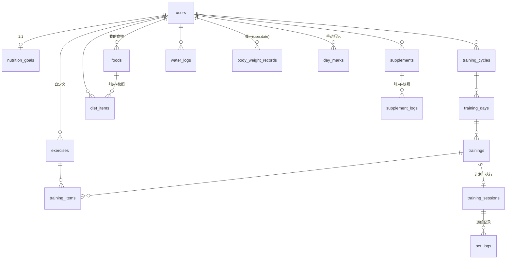
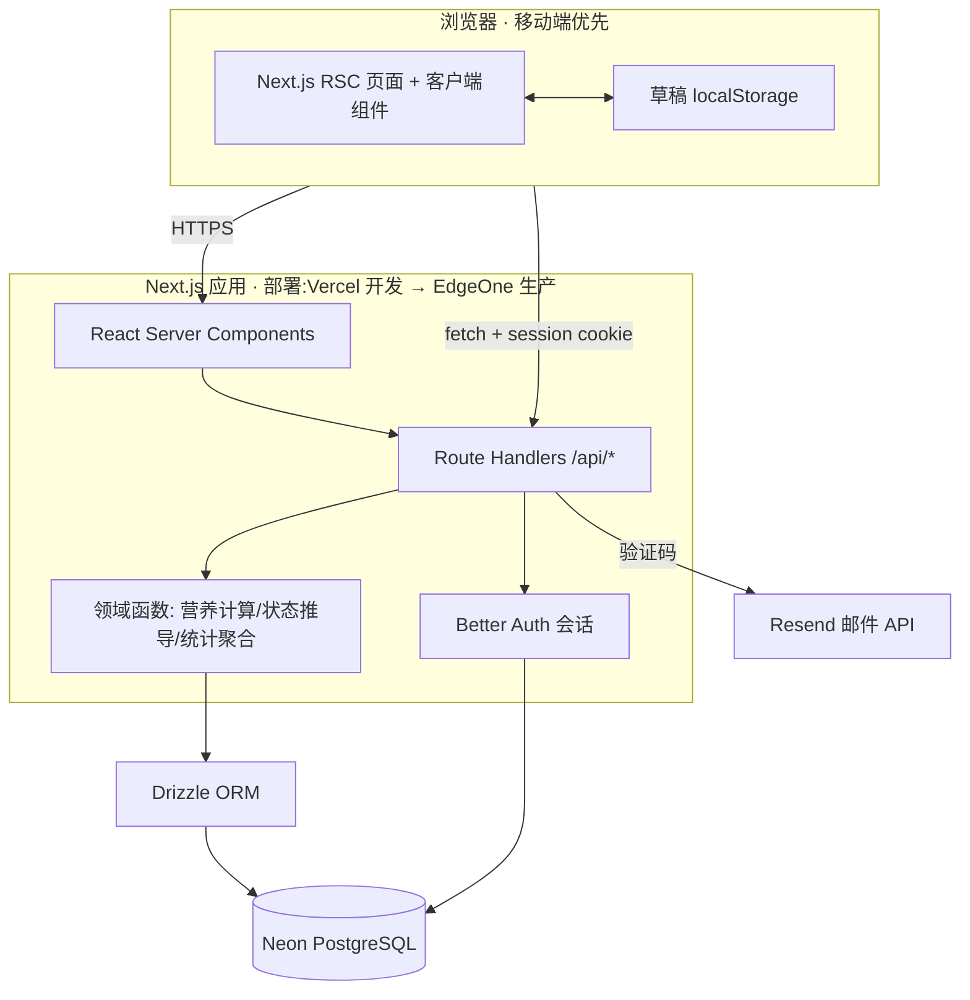
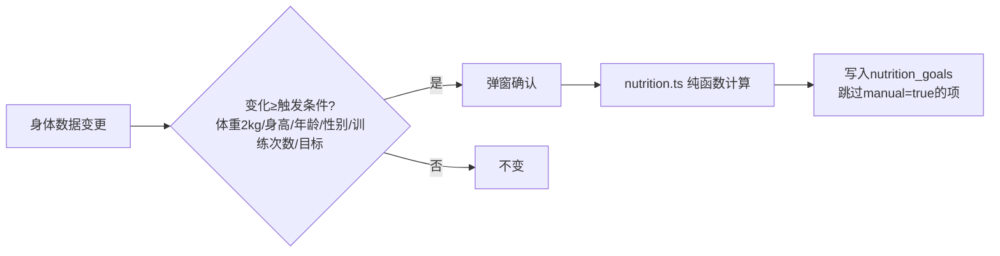

# FitMate 技术文档

| 项目 | 内容 |
| --- | --- |
| 文档版本 | v1.0.2(定稿·冻结) |
| 对应 PRD | v1.6（docs/PRD.md） |
| 当前阶段 | **定稿·冻结**——〇.2 四项决策全部确认；后续重大变更遵循 0.1-5（先改 ADR 再改代码） |
| 最近更新 | 2026-09-14 |

### 更新记录

| 版本 | 日期 | 阶段 | 说明 |
| --- | --- | --- | --- |
| v0.1 | 2026-09-12 | 初稿 | 五大部分 + 15 条 ADR |
| v0.2 | 2026-09-12 | 评审修订 | 采纳 7 条意见:新增 0.1 架构原则;ADR-5 服务层收口、ADR-6 HttpOnly 红线、ADR-8 状态分工、ADR-9 部署分阶段、ADR-14 图表升级触发器、ADR-15 草稿白名单;新增 ADR-16 日志、ADR-17 环境变量 |
| v0.3 | 2026-09-12 | 评审修订 | 确认 2 项决策:部署策略(开发 Vercel 快速验证,生产按国内访问需求及 Next.js 兼容性测试结果选 EdgeOne)、数据访问(薄服务层,业务逻辑禁止写入页面/API 层);同步 ADR-5/9、4.2 分层红线、附录 C 项目规则 |
| v1.0 | 2026-09-12 | 定稿·冻结 | 确认剩余 2 项:平台形态(移动端优先响应式 Web App,V2 用 Capacitor 打包上架)、邮件服务(Resend);〇.2 四项决策全部冻结,进入脚手架阶段 |
| v1.0.1 | 2026-09-12 | 修订 | 复查修复 4+1 项:流程 2 补"0 组完成→未完成"与"今日进行中→未开始"分支(3.1.9/3.2.7);4.1 架构图部署环境与 ADR-9 对齐;nutrition_goals 补 weight_at_calc 基线列;3.1 补"仅当日"服务端 UTC+8 宽松校验约定;ADR-6 注明登录限流由 Better Auth rateLimit 实现 |
| v1.0.2 | 2026-09-14 | 修订 | 认证层落地同步:users.avatar_url 更名 image(Better Auth 标准字段);新增 Better Auth 自管三表 accounts/sessions/verifications(2.2 用户组注明) |

> 定位:PRD 回答"做什么",本文档回答"怎么做"。包含五大部分:技术决策记录、数据模型、API 设计、架构与流程、第三方集成。**变更即更新**——需求或方案变化时同步修订本文档并升版。

---

## 〇、架构原则与待确认决策

### 0.1 架构原则(v0.2 新增,所有 ADR 的上位约束)

1. 优先简单实现,避免过度设计(YAGNI)
2. 能用成熟开源方案,不重复造轮子
3. 保持单体架构,V1 不拆微服务
4. 优先保证可维护性,其次再考虑性能优化
5. 所有重大技术变更必须**先更新 ADR,再修改代码**——"重大"界定:引入/移除依赖、数据模型变更、鉴权方案变更、部署方案变更;其余小改动随 commit 说明即可,防止流程拖慢迭代

### 0.2 决策确认记录(v1.0 全部冻结)

| 决策点 | 结论 | 确认版本 |
| --- | --- | --- |
| 平台形态 | 移动端优先响应式 Web App;V2 用 Capacitor 打包上架(ADR-1) | v1.0 |
| 邮件服务商 | Resend;上线前实测国内到达率,不达标切腾讯云 SES(第五部分) | v1.0 |
| 部署策略 | 开发阶段使用 Vercel 快速验证;生产部署根据国内访问需求及 Next.js 兼容性测试结果选择 EdgeOne(ADR-9) | v0.3 |
| 数据访问 | 薄服务层——函数集中、无 Repository 接口抽象,业务逻辑禁止直接写入页面/API 层(ADR-5) | v0.3 |

其余决策(技术栈、数据库、ORM 等)随 v1.0 一并冻结;后续任何变更先更新 ADR 再改代码(0.1-5)。

---

## 一、技术决策记录(ADR)

> ADR 表是"重大变更"(0.1-5 界定)的唯一登记处:先改表,再改代码。

| # | 决策 | 选择 | 理由 | 放弃的方案及原因 |
| --- | --- | --- | --- | --- |
| 1 | 平台形态 | **移动端优先响应式 Web App**(v1.0 已确认) | 单人 + AI 开发效率最高;PRD 按 5 Tab 单列布局设计,天然适配;上线快、改版快 | 原生(双端维护);RN/Flutter(V1 无需原生能力,相机识别是 V2 的事);小程序(生态封闭,与 Capacitor 路线不兼容) |
| 2 | 全栈框架 | **Next.js(App Router)+ TypeScript** | 全栈一体,前后端类型共享;AI 对其理解最好(生成质量高);RSC 减少手写数据获取 | 前后端分离(SPA + NestJS):双份工程、双份部署,单人项目过度工程 |
| 3 | UI | Tailwind + shadcn/ui + Lucide | 组件源码进项目可改;AI 擅长按 shadcn 填空;移动端卡片式 UI 契合 PRD 原型 | 大型组件库(MUI/AntD):移动端观感差、定制成本高 |
| 4 | 数据库 | **PostgreSQL @ Neon**(Serverless) | PRD v1.1 已定云端方案;Neon 免费档够 V1;分支能力方便迁移脚本测试 | MySQL(Neon 无);Supabase BaaS:供应商锁定,RLS 对个人项目过重;SQLite 本地(PRD 明确 V1 不做离线) |
| 5 | ORM 与数据访问 | **Drizzle + 薄服务层**(v1.0 已确认):所有查询集中 `src/lib/db/queries/*`;**业务逻辑禁止直接写入页面/API 层**——页面与 Route Handler 只做鉴权、入参校验、调用服务函数、组装响应 | 贴近 SQL、类型安全;**Schema 文件即数据模型文档**(与本文档二联动);user_id 过滤与软删条件统一收口——防 AI 在路由层散落裸查询(安全刚需) | interface 式 Repository 抽象层:唯一收益"将来可换 ORM",V1 概率≈0(YAGNI);Prisma:引擎较重、Serverless 冷启动慢 |
| 6 | 认证 | **Better Auth**(邮箱+密码 + emailOTP 验证码) | 数据存自己库、TS 原生、插件覆盖注册验证码/找回密码;**绝不自写认证**(红线);Session 走 **HttpOnly + SameSite Cookie**(Better Auth 默认)——Token/Session 严禁落 localStorage;登录限流(错 5 次锁 15 分钟)由内置 rateLimit 配置实现 | Auth.js(进入维护模式);Firebase Auth(数据在第三方,注销删除数据受制于人,与 AUTH-004 冲突) |
| 7 | 校验 | **Zod**(前后端共享 schema) | PRD 3.2.5 表单规则直接翻译为 schema;防 Postman 直调(后端为主防线) | 仅前端校验(防不住直调);class-validator(生态绑定装饰器) |
| 8 | 状态分工 | 服务端状态 **TanStack Query**;本地 UI 状态 **React State**;不引入全局状态库 | 列表/详情缓存与失效天然满足 3.2.12"修改后各页同步";下拉刷新即 invalidate;V1 无跨组件复杂客户端状态 | Redux/Zustand(无此需求,引入即过度);SWR(可,但 Query 生态更全) |
| 9 | 部署策略 | **开发 Vercel 快速验证 → 生产按需 EdgeOne**(v1.0 已确认):开发阶段使用 Vercel;生产部署根据国内访问需求及 Next.js 兼容性测试结果选择 EdgeOne Pages | Vercel 是 Next.js 一等公民(零配置、PR 预览部署),开发期效率最高;EdgeOne 免备案、国内访问快,但 App Router 全家桶在边缘运行时**需实测**:RSC 渲染、Route Handler、Server Actions、next:image 优化、环境变量注入逐项验证,通过再切;不过则兜底 Docker + 香港 VPS | 写死 EdgeOne(兼容性未验证即承诺);大陆服务器(备案 2~4 周拖慢上线);全程 Vercel(国内访问不稳,正式推广不可接受) |
| 10 | 历史不可变 | **快照字段 + 软删除** | PRD"删除食物/补剂/动作不影响历史"→ 记录表冗余名称与营养快照;主表 deleted_at 软删 | 纯外键引用:删除主数据即破坏历史展示 |
| 11 | "次日自动未完成" | **读取时推导,不建定时任务** | 四态是纯函数:过去日 + 有计划 + 无会话 + 无手动标记 + 非休息 → 未完成。免 cron(serverless 部署复杂)、免漏跑、免多时区错批 | Cron 每日扫描:EdgeOne cron 配置成本 + 用户时区分散(设备时区边界,PRD 3.8.8)导致批次错切 |
| 12 | 日期与时区 | **date(设备时区日历日)+ timestamptz(UTC)双轨** | PRD"今日=设备时区 00:00"→ 日期字段存日历日字符串,由客户端生成并显式传参;时刻存 UTC | 纯 UTC 日界:与国内用户"今天"直觉冲突,统计会错天 |
| 13 | 体重同日覆盖 | UPSERT + 唯一约束 (user_id, date) | 3.2.6 同日覆盖确认后 upsert,天然防重复 | 先查后写:并发下产生双条 |
| 14 | 图表 | **V1 手写 SVG 体重折线;触发器升级 Recharts**——图表种类 ≥2 或需交互(悬浮提示/缩放)时引入 | V1 全项目仅体重折线一张静态图(3.11.7),100 行内零依赖;但 V1.1"更多统计图表"(P2 已排队)大概率触发,按触发器升级避免来回返工 | 现在就引 Recharts:为一张静态折线引 ~100KB,属过早引入;永久手写 SVG:图表多起来后维护成本反超 |
| 15 | 草稿 | **客户端 localStorage**(键 `draft:{userId}:{formType}`) | PRD 3.3.5 明确"草稿仅本地、不同步服务器"——不建表、不上云;**localStorage 白名单:仅表单草稿**,严禁存 Token/Session/用户信息(防 AI 误存敏感数据) | 草稿表:违反 PRD 且增加写放大 |
| 16 | 日志 | 开发 **console**;生产 **Sentry**(上线前接入) | 上线后排障靠错误上报:客户端 + 服务端异常统一收口,带版本/用户上下文;免费档 5k errors/月够 V1 | 自建日志系统(重复造轮子);仅靠平台日志(检索/告警弱、保留期短) |
| 17 | 环境变量 | **所有密钥仅存 `.env`**;禁止硬编码 API Key / 数据库密码(代码、示例、注释均不允许) | AI 生成代码的高频错误点;密钥一旦提交,删除无效(Git 历史仍在),必须重置+清历史——预防成本远低于善后 | 无备选(红线) |

---

## 二、数据模型

### 2.1 ER 图



> 官方数据(动作库 80 条、食物库)与用户自建数据同表,以 `owner_id IS NULL` 区分官方、`IS NOT NULL` 为用户私有。

### 2.2 表定义

**用户与账号(1~3)**

| 表 | 字段要点 | 约束/索引 |
| --- | --- | --- |
| users | id(uuid)、email、password_hash(Better Auth 管理,存 accounts 表)、nickname、image(头像 URL,Better Auth 标准字段)、gender、age、height_cm、body_fat_pct、goal_type、target_weight_kg、target_date、weekly_training_days、onboarded_at、deletion_requested_at、created_at | email 唯一;deletion_requested_at 非空即处于 15 天冷静期;另有 Better Auth 自管三表 accounts/sessions/verifications(v1.0.2 认证层落地) |
| nutrition_goals | user_id(PK/FK)、calories_kcal、protein_g、carbs_g、fat_g、water_ml、manual_calories/manual_protein/manual_carbs/manual_fat/manual_water(5 个布尔)、weight_at_calc(上次计算时体重)、recalculated_at | 手动项标记(3.4.3 不覆盖规则);weight_at_calc 为"体重变化 2kg 触发"的比较基线(每次计算时写入) |
| verification_codes | id、email、code_hash、purpose(register/reset/delete)、expires_at、attempts、created_at | 邮箱验证码由 Better Auth emailOTP 管理,此表仅兜底记录;查询 (email, created_at) 计数限频(3.6.3:60s 冷却、日 5 次) |

**训练(4~9)**

| 表 | 字段要点 | 约束/索引 |
| --- | --- | --- |
| training_cycles | id、user_id、name、start_date、end_date、status(未开始/进行中/已结束)、created_at、deleted_at | **部分唯一索引**:每用户仅一行 status='进行中' |
| training_days | id、cycle_id、date、is_rest | 唯一 (cycle_id, date);is_rest=休息日(3.1.5) |
| trainings | id、training_day_id、name、muscle_group、sort_order | 一天多训练=多行(v1.5 追加制) |
| training_items | id、training_id、exercise_id、sets、reps、target_weight、rest_seconds(默认90)、sort_order | 计划参数;同一动作可重复添加(3.2.9) |
| training_sessions | id、user_id、training_id、date、status(进行中/已完成)、started_at、ended_at、duration_seconds | **部分唯一**:每用户仅一个 status='进行中'(中断恢复依据,3.1.10) |
| set_logs | id、session_id、training_item_id、set_index、actual_weight、actual_reps、completed、completed_at | 逐组记录,总结页与历史的唯一数据源 |
| day_marks | id、user_id、date、kind(未完成标记) | 同日撤销=删行(3.1.9) |
| exercises | id、owner_id(空=官方)、name、category、muscle_group、deleted_at | 官方 80 条种子数据;搜索索引 (owner_id, name) |

**饮食/补剂/饮水/体重(10~15)**

| 表 | 字段要点 | 约束/索引 |
| --- | --- | --- |
| foods | id、owner_id(空=官方)、name、kcal_per100、protein_per100、carbs_per100、fat_per100、is_liquid、deleted_at | 用户食物仅本人可见;索引 (owner_id, name) |
| diet_items | id、user_id、date、meal_type(早/午/晚/加餐)、food_id、**快照:name+4 项 per100**、grams | 快照满足"删除食物不影响历史"(3.8.4);索引 (user_id, date);补记窗口由 date 天然支持 |
| supplements | id、user_id、name、unit(勺/g/粒/片/ml)、dose、daily_target、deleted_at | 快照需求同上 |
| supplement_logs | id、user_id、supplement_id、**快照:name+unit**、dose、logged_at、date | 一天多次,带时间戳;索引 (user_id, date) |
| water_logs | id、user_id、date、amount_ml、logged_at | 索引 (user_id, date);左滑删单条 |
| body_weight_records | id、user_id、date、weight_kg、created_at | **唯一 (user_id, date)**:同日覆盖走 upsert(3.2.6) |

**统计辅助(16~17)**

| 表 | 字段要点 | 说明 |
| --- | --- | --- |
| events | id、user_id、name、props(jsonb)、created_at | 服务端埋点(P2-24 口径见附录 B);V1 不引入第三方分析 |
| (无草稿表) | — | 草稿在客户端 localStorage(ADR-15) |

### 2.3 全局约定

- **类型**:热量/次数 int;重量/克数/剂量 numeric(10,1);时间 timestamptz(UTC);日期 date(客户端设备时区的日历日,ADR-12)
- **软删除**:所有用户主数据 deleted_at;记录类(会话/组/饮食条目等)不物理改,错误记录走"删除单条+二次确认"
- **外键一律在"多"的一方,且手动加索引**(PG 不自动为 FK 建索引——最常见性能陷阱)
- **UPDATE/DELETE 必带 WHERE 且带 user_id**(服务端权限双层校验的第一层)
- **体重权威源**:body_weight_records 最新一条;users 不存当前体重,个人资料页编辑体重=触发当日 upsert

### 2.4 实体覆盖校验(PRD 业务实体 → 表)

users✓ 营养目标✓ 训练周期✓ 休息日✓ 计划训练✓ 动作库✓ 计划动作项✓ 训练会话✓ 逐组记录✓ 手动标记✓ 食物库✓ 自定义食物✓ 饮食条目✓ 补剂✓ 补剂打卡✓ 饮水记录✓ 体重记录✓ —— **17/17 覆盖**

---

## 三、API 设计

### 3.1 通用约定

- **统一响应**:成功 `{success:true, data}`;失败 `{success:false, error:{code,message}}`
- **错误码**:400 VALIDATION_ERROR / 401 UNAUTHORIZED / 403 FORBIDDEN / 404 NOT_FOUND / 409 CONFLICT / 429 RATE_LIMITED / 500 INTERNAL
- **鉴权**:Better Auth session cookie;除注册/登录/验证码/协议页外全部需登录
- **权限双层**:中间件验 session → 业务层校验资源 `WHERE user_id = session.user.id`(隐私数据红线)
- **日期参数**:所有"当日"接口必须由客户端显式传 `date=YYYY-MM-DD`(设备时区,ADR-12),服务端校验范围(如饮食补记限过去 7 天);"仅当日"接口(饮水/补剂/体重)按 **UTC+8 宽松校验**——date 不得为未来、不得早于昨日即可,服务端不感知客户端时区,严格时区校验 V1 不做,唯一约束兜底
- **防重复**:按钮 Loading(3.2.2)+ 数据库唯一约束兜底
- **列表**:搜索类接口默认分页 page/pageSize(20)
- **不混用 Server Actions**:V1 数据变更统一走 Route Handler(与 TanStack Query 缓存/失效模型配套,ADR-8);Server Actions 取舍在 V2 复评,部署兼容清单仍验证它(ADR-9)

### 3.2 端点清单(按模块)

**账号 AUTH(3.6)**

| 方法 路径 | 职责 | 需求 |
| --- | --- | --- |
| POST /api/auth/send-code | 发送验证码(60s 冷却/日 5 次,purpose 分流) | AUTH-001/004 |
| POST /api/auth/register | 注册(邮箱+验证码+密码+协议勾选) | AUTH-001/005 |
| POST /api/auth/login / logout | 登录(错 5 次锁 15 分钟)/登出 | AUTH-001 |
| POST /api/auth/reset-password | 忘记密码(验证码+新密码) | AUTH-001 |
| POST /api/account/deletion | 提交注销(验证码确认,记 deletion_requested_at) | AUTH-004 |
| POST /api/account/deletion/cancel | 冷静期内取消注销 | AUTH-004 |
| GET/PATCH /api/me | 读/改个人资料(改身体数据触发重算提示) | AUTH-002 |
| GET/PATCH /api/me/goals | 读/手动调整营养目标(标记 manual_*) | AUTH-003 |
| POST /api/onboarding | 完成首次设置(4 步一次性提交) | AUTH-002/003 |

**训练 WORKOUT(3.1)**

| 方法 路径 | 职责 | 需求 |
| --- | --- | --- |
| GET/POST /api/cycles | 周期列表(含状态)/创建 | WORKOUT-001 |
| PATCH/DELETE /api/cycles/:id | 改周期/删周期(只影响未来,3.2.8) | WORKOUT-001 |
| POST /api/cycles/:id/activate | 激活周期(已有进行中→409 由前端弹确认后带 force) | WORKOUT-001 |
| GET /api/cycles/:id/days?week= | 某周每天的 计划/状态/休息日 | WORKOUT-005 |
| POST /api/days/:date/trainings | 追加当日训练(多训练追加制) | WORKOUT-002 |
| PATCH/DELETE /api/trainings/:id | 改训练名/删除(未来) | WORKOUT-002 |
| POST /api/trainings/:id/items、PATCH/DELETE /api/training-items/:id | 计划动作增改删 | WORKOUT-003/004 |
| PUT /api/trainings/:id/items/order | 调整动作顺序 | WORKOUT-008 |
| POST /api/days/:date/set-rest | 设/取消休息日(仅未来,二次确认由前端) | WORKOUT-002 |
| POST /api/days/:date/mark-incomplete / undo | 手动标记未完成/当日撤销 | WORKOUT-006 |
| POST /api/sessions | 开始训练(生成会话,409 若已有进行中→前端走恢复流程) | WORKOUT-011 |
| GET /api/sessions/current | 中断恢复查询 | WORKOUT-011 |
| POST /api/sessions/:id/sets | 提交一组(实际重量/次数/完成) | WORKOUT-011 |
| PATCH /api/sessions/:id/finish | 结束训练(全部完成/提前结束统一入口) | WORKOUT-011 |
| GET /api/sessions/:id/summary | 训练总结(容量等即时聚合) | WORKOUT-010 |
| GET /api/trainings/history?range= | 训练历史(只读) | WORKOUT-007 |
| GET/POST /api/exercises、PATCH/DELETE /api/exercises/:id | 动作库搜索分页/自定义动作(官方不可删,403) | WORKOUT-009 |

**饮食/补剂/饮水/体重 NUTRITION·SUPPLEMENT·WATER·STAT**

| 方法 路径 | 职责 | 需求 |
| --- | --- | --- |
| GET /api/foods?search= | 官方+我的食物联合搜索(分页 20) | NUTRITION-001 |
| POST /api/foods、PATCH/DELETE /api/foods/:id | 自定义食物增改删 | NUTRITION-002 |
| GET /api/diet?date= | 四餐+条目+四项总计+目标对照 | NUTRITION-004 |
| POST /api/diet/items | 添加食物条目(餐次+food_id+grams,校验 1~5000) | NUTRITION-001/003 |
| PATCH/DELETE /api/diet/items/:id | 改重量(重算)/删条目(重算) | NUTRITION-003 |
| GET/POST /api/supplements、PATCH/DELETE /api/supplements/:id | 补剂管理 | SUPPLEMENT-001 |
| GET /api/supplements/today、POST /api/supplement-logs、DELETE /api/supplement-logs/:id | 今日打卡/记录(带时间戳)/删单条 | SUPPLEMENT-002 |
| GET /api/water/today、POST /api/water/logs、DELETE /api/water/logs/:id | 今日饮水/记录(1~2000)/删单条 | WATER-001/002 |
| GET /api/weight/records?range=7\|30\|90、POST /api/weight/records | 体重趋势/记录(同日 upsert 前端先确认) | STAT-005 |

**统计与首页 STAT·SYSTEM**

| 方法 路径 | 职责 | 需求 |
| --- | --- | --- |
| GET /api/stats/today | 首页 5 卡片聚合(训练四态+营养+饮水+补剂+体重) | SYSTEM-001 / STAT-001 |
| GET /api/stats/week、/api/stats/month | 周/月统计(完成率公式、营养日均,见 3.11.4) | STAT-002/003 |
| GET /api/stats/calendar?month= | 训练日历月视图 | STAT-004 |

### 3.3 功能覆盖校验(需求 → 接口)

AUTH-001~005 ✓(send-code/register/login/reset/deletion/me)WORKOUT-001~011 ✓(共 19 端点)NUTRITION-001~004 ✓ SUPPLEMENT-001/002 ✓ WATER-001/002 ✓ STAT-001~005 ✓(today/week/month/calendar/weight)SYSTEM-001 ✓(stats/today)SYSTEM-002 ✓(数据库本体)SYSTEM-003 深色模式=CSS 变量方案(无接口)SYSTEM-004 提醒=V2 无接口 SYSTEM-005 草稿=客户端无接口 —— **35/35 覆盖**

---

## 四、架构与关键流程

### 4.1 系统架构



### 4.2 项目结构

```text
src/
├── app/                      # 路由(5 Tab + 功能页)
│   ├── (auth)/login|register|forgot/
│   ├── (main)/dashboard|train|diet|stats|me/
│   └── api/…                 # Route Handlers(三、端点清单)
├── db/
│   ├── schema.ts             # Drizzle Schema = 本文档二的代码化
│   └── seed/                 # 官方动作库80条 + 食物库
├── lib/
│   ├── db/queries/           # 全部 Drizzle 查询(服务层收口,ADR-5)
│   ├── nutrition.ts          # 3.4 公式(纯函数)
│   ├── dayStatus.ts           # 四态推导(纯函数,ADR-11)
│   ├── stats.ts               # 完成率/容量/日均聚合
│   └── validation/            # Zod schema(前后端共享)
└── components/ui/…            # shadcn/ui + SVG 折线图组件
```

**分层红线(ADR-5,v0.3 确认)**:`app/` 下的页面与 Route Handler 只做四件事——鉴权、入参校验、调用服务函数、组装响应;业务规则(营养计算/四态推导/统计聚合)在 `lib/` 纯函数,数据访问在 `lib/db/queries/`。

### 4.3 关键流程

**流程 1:训练执行与状态判定**

```mermaid
sequenceDiagram
    participant U as 用户
    participant A as API
    participant D as 数据库
    U->>A: POST /sessions(开始训练)
    A->>D: insert training_sessions(status=进行中)
    loop 每组
        U->>A: POST /sessions/:id/sets(实际重量/次数)
        A->>D: insert set_logs
    end
    U->>A: PATCH /sessions/:id/finish
    A->>D: 更新会话+ended_at
    A-->>U: GET summary(总容量=Σ实际重量×次数×组)
    Note over D: 当天四态=查询时推导:<br/>完成≥1组→已完成;0组→未完成<br/>(提前结束同规则,3.2.7)
```

**流程 2:四态推导(ADR-11,纯函数)**

```text
输入:date、该日计划(trainings+is_rest)、会话、set_logs、day_marks
is_rest                        → 💤 休息日
会话已结束(或过期日的滞留进行中,按提前结束规则):
    完成组数 ≥1               → ✅ 已完成
    完成组数 = 0               → ❌ 未完成(3.1.9/3.2.7:0 组记未完成)
今日会话进行中                  → ○ 未开始(UI 叠加"训练中·继续"标识,3.7.3)
有 day_marks                   → ❌ 未完成(手动)
date < 今天 且有计划            → ❌ 未完成(过期自动,免cron)
否则                           → ○ 未开始
```

**流程 3:营养目标管线**



**流程 4:今日汇总(首页)**

`GET /stats/today` 并行聚合 5 查询:今日训练状态(流程 2)|今日 diet_items 四项求和 vs goals|water_logs 求和 vs 目标|supplement_logs 计数 vs 目标|体重最新两条差值。全部走 (user_id, date) 索引。

### 4.4 安全与性能要点

- `.env` 三件套开工首日配好:`.gitignore` 含 `.env`、提交 `.env.example`、本地 `.env`(键见第五部分);密钥仅存 `.env`,严禁硬编码(ADR-17 红线)
- 写接口 Zod 全量校验(边界与 PRD 3.2.5 一致)
- 验证码限频:60s 冷却 + 日 5 次(DB 计数,V1 不引 Redis)
- 隐私红线:所有用户数据查询必带 user_id;健康数据属敏感个人信息,接口不落日志明文
- UPDATE/DELETE 必带 WHERE + user_id;唯一约束兜底防重

---

## 五、第三方集成

| 服务 | 用途 | 环境变量 | 额度/限制 | 备注 |
| --- | --- | --- | --- | --- |
| Neon PostgreSQL | 数据库 | `DATABASE_URL` | 免费档:0.5GB 存储,不活跃自动暂停(正常现象) | 恢复冷启动 ~1s |
| Resend(v1.0 已确认) | 注册/找回/注销验证码邮件 | `RESEND_API_KEY`、`EMAIL_FROM` | 免费 3000 封/月,100 封/日 | 上线前实测国内到达率,不达标切腾讯云 SES(0.2 决策记录) |
| Better Auth | 会话与密码 | `BETTER_AUTH_SECRET`、`BETTER_AUTH_URL` | 无额度(自托管于自有库) | emailOTP 插件承载验证码 |
| Vercel | 开发/内测部署 | 控制台配置同上三组 | 免费 Hobby 档(禁止商用,正式推广前须切走) | Next.js 一等公民零配置;ADR-9 切换前的主力环境 |
| EdgeOne Pages(验证后) | 生产部署/CDN | 控制台配置同上三组 | 免费档含 CI 构建 | 切换前过 ADR-9 兼容清单;构建命令 `pnpm build` |
| Sentry | 生产错误监控(上线前接入) | `SENTRY_DSN`(仅生产) | 免费 5k errors/月 | ADR-16;开发期用 console |
| —(其余) | — | — | — | 图表按 ADR-14 触发器决定;V1 无支付/地图/推送 |

---

## 附录

### A. 测试策略(20% 覆盖 80% 风险)

- **Vitest 单测(必须)**——纯函数是事故高发区:
  - `nutrition.ts`:Mifflin-St Jeor、活动系数、四类目标调整(含减脂下限保护 BMR)、四舍五入规则(3.4)
  - `dayStatus.ts`:四态推导全分支(含过期自动未完成、休息日)
  - `stats.ts`:完成率公式(休息日/未来日不计分母)、总容量(无重量动作跳过)、营养日均
  - upsert 体重:同日覆盖并发
- **Playwright E2E(3 条主流程)**:注册→首次设置→创建周期并添加动作;执行训练(含中断恢复)→总结;记录一餐+饮水+补剂→首页卡片核对
- 每个 bug 修复后为对应纯函数补一条用例

### B. 埋点口径(P2-24 关闭)

| 指标 | 口径 | 实现 |
| --- | --- | --- |
| 人均每日记录次数 ≥3 | (饮食条目创建 + 补剂打卡 + 饮水记录 + 体重记录 + 完成训练会话)÷ DAU,当日 | events 表服务端埋点 |
| 数据面板查看率 ≥40% | 访问过 /stats 页的去重用户 ÷ DAU | 页面加载事件 |

### C. 项目规则文件(开工首日写入 CLAUDE.md / .trae/rules)

```text
# FitMate 项目规则
- 技术栈:Next.js(App Router)+ TS strict + Tailwind + shadcn/ui + Drizzle + Better Auth + Zod
- 包管理只用 pnpm;禁止安装新依赖(需人工确认)
- 禁 any;组件用函数式;严格模式
- 禁止改动 .env / 数据库迁移文件(迁移只新增不修改)
- 所有用户数据查询必须带 user_id 条件
- 业务逻辑禁止写在页面/API 层:数据访问走 lib/db/queries,业务规则走 lib 纯函数
- 每完成一个独立功能即 git commit
- 常用命令:pnpm dev / pnpm build / pnpm test / pnpm db:generate / pnpm db:migrate
```

### D. 与 PRD 里程碑对接

本文档即 PRD 4.6-7 所指"技术栈文档"外部输入。评审冻结后:第 3 周技术设计 → 第 4 周起按 PRD 4.2 四阶段开发,第一阶段从 pnpm 脚手架 + 三件套 + Schema 开始(Schema 即文档二)。
